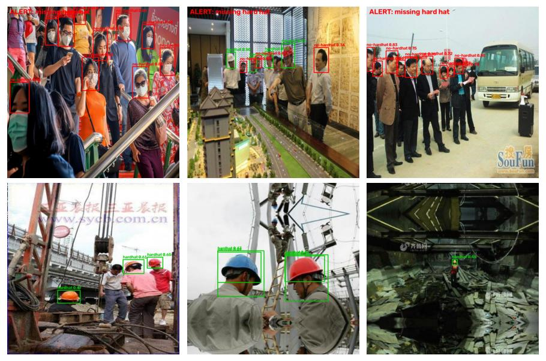

# 07 · PPE Safety Monitor (Hard Hats)

Detects every head in an image as **wearing a hard hat** or **not**, and raises a site alert
when anyone is missing one. YOLO11n (COCO-pretrained) fine-tuned on a laptop CPU; evaluated both
as an object detector (mAP) and as the alert a safety manager would actually receive.



*Top: images with violations, where the alert fires. Bottom: compliant images, with hard hats detected (green).*

## Results

Full test split: 2,001 images.

### Object level

| Class | AP50 | AP50-95 |
|---|---|---|
| hardhat | 0.846 | 0.439 |
| no-hardhat | 0.809 | 0.475 |
| **mean** | **0.828** | **0.457** |

Inference: ~51 ms per 640×640 image on CPU.

### Site-alert level

Ground truth per image: "is at least one person missing a hard hat?" (413 of 2,001 images).
The alert fires when the model sees any "no-hardhat" head above the confidence threshold.

| Confidence threshold | Alert precision | Alert recall (violations caught) | Missed violations | False alarms |
|---|---|---|---|---|
| **0.25** | 87.8 % | **90.8 %** | 38 | 52 |
| 0.40 | 92.0 % | 83.1 % | 70 | 30 |
| 0.50 | 95.8 % | 77.0 % | 95 | 14 |
| 0.60 | 97.0 % | 55.2 % | 185 | 7 |

For safety, a missed violation is worse than a false alarm, so a low threshold (0.25) is the right
default: 9 in 10 violation scenes are flagged, and about 1 alert in 8 is unnecessary.

## How it works

1. **Data prep** ([`prepare.py`](prepare.py)): a random 1,500 / 300 train / validation subset is extracted
   straight from the downloaded zip into the YOLO layout with short file names. The full 13,782-image
   folder would overflow a FAT32 directory (see project 06).
2. **Training** ([`train.py`](train.py)): YOLO11n from COCO weights, 640 px, 10 epochs on CPU (~1.4 h).
   Validation mAP50 rose from 0.45 after epoch 1 to 0.81 after epoch 10 and was still climbing
   (per-epoch values in the training log, `../../cv-data/ppe/outputs/runs/yolo11n_ppe/results.csv`).
3. **Evaluation** ([`evaluate.py`](evaluate.py)): COCO-style mAP on the test split, then image-level
   alerts swept over the confidence threshold.

## Data

- **Hard Hat Workers** dataset (Roboflow, Hugging Face mirror `keremberke/hard-hat-detection`): 13,782 / 3,962 /
  2,001 train / valid / test images, classes `hardhat` and `no-hardhat` (head boxes).
- **Location:** `../../cv-data/ppe/` (not committed).

## Run it

```bash
.venv\Scripts\activate            # shared environment, from the repo root
cd 07-ppe-safety-monitor
python prepare.py                 # extract the YOLO subset from the zips
python train.py --epochs 10       # ~1.4 h on CPU; --resume continues an interrupted run
python evaluate.py                # mAP, alert sweep, examples
```

## What I learned / what didn't work

- **Harder than license plates.** Heads are small and crowded (one image can have 20+), and helmets
  come in many colors and angles: mAP50 0.83 vs 0.98 for plates with the same model and training budget.
- **The model was still improving at epoch 10.** More epochs (and the full 13.8k training images
  instead of 1,500) would clearly help; CPU time was the limit.
- **Many "violation" images aren't construction sites.** The dataset includes street and subway
  crowds with bare heads, so "no-hardhat" partly means "a visible bare head anywhere". A real
  deployment should be validated on footage from the actual site.
- **Report the alert, not just mAP.** mAP 0.83 doesn't tell a site manager much; "90 % of violations
  flagged, 1 alert in 8 unnecessary" does.

## Next steps

- Train longer on the full training set (GPU), add vests and other PPE.
- Run on video with tracking (project 08) so each person triggers one alert, not one per frame.
- Auto-label new site footage with Grounding DINO (project 17), review, and fine-tune.

## Tech stack

Python · Ultralytics YOLO11 · OpenCV · NumPy · Matplotlib
