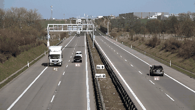
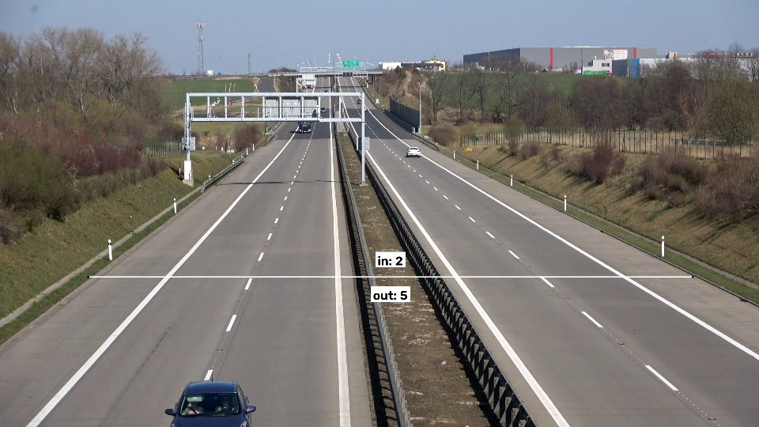
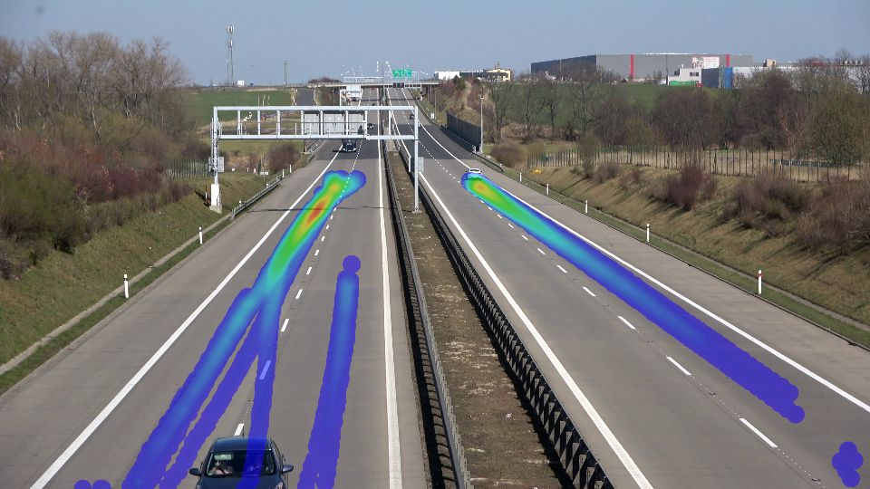

# 08 · Traffic Analytics

Detects, tracks, counts and **measures the speed** of vehicles on a highway video, and builds a
heatmap of where they drive. The full pipeline (detection → multi-object tracking → line
counting → perspective-corrected speed estimation) runs on a laptop CPU.



## Results

On the 4K sample highway video (538 frames, ~21 s):

| Metric | Value |
|---|---|
| Vehicles tracked (unique IDs) | 19 (10 cars, 6 trucks, 3 buses) |
| Counting line crossings | 2 in · 5 out |
| Median / mean speed | 119 / 109 km/h (plausible for a 130 km/h motorway) |
| Processing speed | 3.4 FPS on CPU at 4K input (YOLO at 960 px) |

<p float="left">
  
  
</p>

*Left: tracked vehicles with IDs, speeds and the counting line. Right: accumulated traffic heatmap.*

## How it works

1. **Detection**: YOLO11n (COCO-pretrained) finds cars, motorcycles, buses and trucks in each
   frame. Frames are resized to 960 px for the model, a trade-off between speed and small/far vehicles.
2. **Region of interest**: only detections inside the road polygon are kept. That removes
   parked or distant vehicles that would be too small to measure.
3. **Tracking**: ByteTrack links detections across frames into tracks with stable IDs. It
   also uses low-confidence detections to keep tracks alive through brief occlusions.
4. **Counting**: a virtual line counts each track once when it crosses, in each direction.
5. **Speed estimation**: a perspective transform (homography from 4 road points to a
   25 m × 250 m rectangle) maps each vehicle's bottom-center point from pixels to meters on the
   road. Speed = distance travelled along the road over the last second (km/h).
6. **Heatmap**: vehicle positions accumulate into a heatmap of lane usage.

### Why the perspective transform matters
In the image, a car near the camera moves many more pixels per second than one far away at
the same speed. Mapping to a bird's-eye view in meters makes speeds comparable anywhere on the road.

## Data

- **Video:** `vehicles.mp4` from Roboflow's [supervision](https://github.com/roboflow/supervision)
  sample assets (downloaded automatically on first run to `../../cv-data/traffic/`).
- **Model:** YOLO11n COCO weights from Ultralytics (downloaded automatically, AGPL-3.0).
- **Calibration:** road polygon and real-world size (≈ 25 m × 250 m) for this camera view.

## Run it

```bash
.venv\Scripts\activate            # shared environment, from the repo root
cd 08-traffic-analytics
python traffic.py                              # sample video
python traffic.py --video my_clip.mp4 --max-frames 300
```

The annotated video is saved to `../../cv-data/traffic/outputs/traffic_annotated.mp4`. For your own
camera, change `SOURCE` (4 road corners in pixels), `TARGET_W/H` (their real size in meters) and `LINE`.

## What I learned / what didn't work

- **Speed is only as good as the calibration.** The 25 m × 250 m road size is an estimate; a
  10 % error there is a 10 % speed error. Real deployments measure lane markings
  (dashed lines have standard lengths) to calibrate. The speeds are also **not validated** against
  ground truth (no radar/GPS data for this video): they're plausible, not measured.
- A code review found the road rectangle mapped 250 m to 249 units (speeds ~0.4 % low). Fixed in the
  code; the numbers above come from the run before the fix.
- **Far vehicles are the weak point.** At the top of the frame cars are a few pixels tall, so the
  road polygon starts below them on purpose. Detecting them would need a larger input size or
  a model fine-tuned on traffic footage.
- **CPU throughput (3.4 FPS at 4K)** is fine for offline analysis but not live video. Project 19
  benchmarks the same detector with OpenVINO on this laptop's iGPU and NPU.
- `sv.ByteTrack` is deprecated in supervision 0.30 (removed in 0.31); pin `supervision<0.31` or
  migrate to the new tracker API.

## Next steps

- Fine-tune the detector on traffic data for small, far-away vehicles.
- Run on OpenVINO (iGPU) for real-time throughput.
- Per-lane counts and speed-limit violation flags.

## Tech stack

Python · Ultralytics YOLO11 · supervision (ByteTrack, zones, annotators) · OpenCV (homography)
