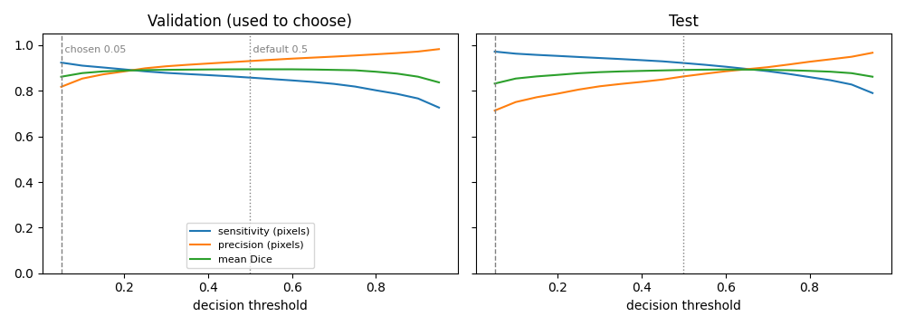
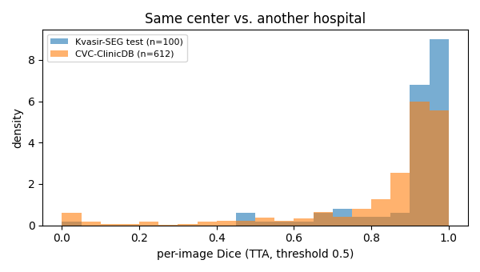
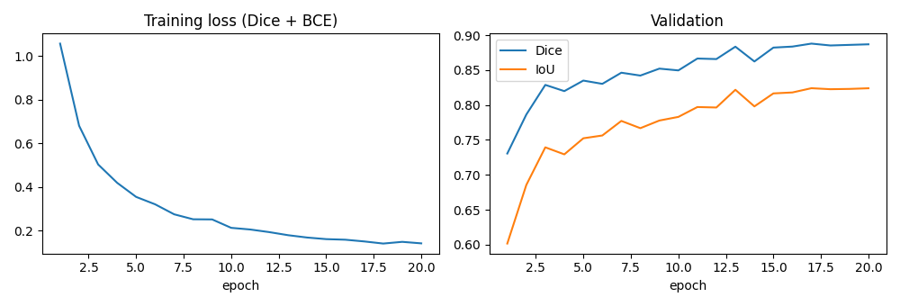

# 11 · Medical Image Segmentation: Polyps in Colonoscopy

Outlines **colorectal polyps** pixel by pixel in colonoscopy images with a **U-Net** (ResNet-18
encoder, ImageNet-pretrained), trained on a laptop CPU. Polyps are precursors of colorectal
cancer; automatic segmentation helps endoscopists not miss them. Beyond the usual Dice score, the
project measures what matters for a screening tool: **test-time augmentation**, a **decision threshold
tuned for sensitivity** on validation data, and **generalization to another hospital** (CVC-ClinicDB).

> No endoscopy images are shown: both datasets (Kvasir-SEG, CVC-ClinicDB) are licensed for research /
> education only and do not allow redistribution. All figures below are charts computed from them.

## Results

All numbers come from one retrained model (`docs/results.json`): 20 epochs on CPU, best checkpoint at
epoch 17 (validation Dice 0.888). Kvasir-SEG test = 100 held-out images never used for training,
checkpoint selection or threshold choice. CVC-ClinicDB = 612 frames from **another hospital**, never seen.

### Same center (Kvasir-SEG test) and the effect of test-time augmentation

| Kvasir-SEG test, threshold 0.5 | no TTA | flip TTA (4 views) |
|---|---|---|
| **Mean Dice** | 0.886 | **0.892** |
| **Mean IoU** | 0.823 | **0.829** |
| Median Dice | 0.942 | 0.946 |
| Pixel sensitivity / precision | 0.909 / 0.867 | 0.922 / 0.863 |
| Missed polyps (< 50 % of the polyp found) | 5 % | 3 % |
| Inference (CPU, 256×256) | 92 ms / image | 363 ms / image |

TTA adds **+0.005 Dice** on average, but image by image it helps 20 test images and hurts 19 (by more
than 0.01 Dice): a small, noisy gain for 4× the compute. On CVC-ClinicDB it adds nothing (0.825 → 0.825).

### Screening threshold (chosen on validation, reported on test)

A missed polyp is worse than a false alarm, so the threshold is chosen on the **validation** split to
maximize pixel-level F2 (sensitivity counts 4× more than precision). Validation picked **0.05**.

| Flip TTA | threshold 0.5 (default) | threshold 0.05 (F2 on validation) |
|---|---|---|
| Kvasir test: pixel sensitivity | 0.922 | **0.972** |
| Kvasir test: pixel precision | 0.863 | 0.713 |
| Kvasir test: mean Dice | 0.892 | 0.832 |
| Kvasir test: missed polyps | 3 % | 2 % |
| CVC-ClinicDB: pixel sensitivity | 0.804 | **0.903** |
| CVC-ClinicDB: pixel precision | 0.898 | 0.696 |
| CVC-ClinicDB: mean Dice | 0.825 | 0.779 |
| CVC-ClinicDB: missed polyps | 10.6 % | **4.4 %** |

The low threshold finds more of every polyp and, more importantly, more than halves the polyps missed
on the unseen hospital (10.6 % → 4.4 % of frames), at the cost of 2.7× (Kvasir) to 4.3× (CVC) more false-alarm area and
about 5 Dice points. Dice is the wrong objective for screening; this table shows the trade-off explicitly.



*Sensitivity, precision and mean Dice against the decision threshold. Left: validation, where the
threshold is chosen. Right: test, only scored afterwards; the curves have the same shape.*

### Another hospital (CVC-ClinicDB)

| Flip TTA, threshold 0.5 | Kvasir-SEG test (same center) | CVC-ClinicDB (other center) |
|---|---|---|
| Mean Dice | 0.892 | **0.825** |
| Mean IoU | 0.829 | 0.748 |
| Median Dice | 0.946 | 0.914 |
| Images with Dice > 0.8 | 84 % | 77 % |
| Images with Dice < 0.5 (failures) | 4 % | 9 % |

Moving to a different hospital, endoscope and resolution (384×288 frames instead of Kvasir's mostly
larger ones) costs **about 7 Dice points** on average. The median barely moves: most frames are still
segmented well, but the failure tail doubles (4 % → 9 % of images below Dice 0.5), and sensitivity drops
more than precision (0.92 → 0.80 vs 0.86 → 0.90): the model under-segments unfamiliar polyps rather
than hallucinating new ones.



### Reproducing the original baseline

The original weights were lost with a USB key, so the model was retrained from scratch with the same
script, split and hyper-parameters:

| | Original run (README v1) | Retrained (this run) |
|---|---|---|
| Test mean Dice / IoU (no TTA) | 0.897 / 0.833 | 0.886 / 0.823 |
| Test median Dice | 0.937 | 0.942 |
| Best validation Dice (epoch) | 0.882 (14) | 0.888 (17) |
| Time per epoch | ~3.5 min | 3.3–4.6 min (CPU shared with other jobs) |

The retrained model is 0.011 Dice lower on test but 0.006 higher on validation. The original run used
unseeded augmentations (since fixed) and was interrupted in its last epoch, so it cannot be replayed
exactly. With 100 test images and a per-image Dice standard deviation of roughly 0.15–0.2, the standard error of the
mean is roughly 0.015–0.02, so the gap is within run-to-run noise. The 92 ms vs 69 ms inference difference
comes from the laptop running other agents' work at the same time.

For reference, published U-Net baselines on Kvasir-SEG report Dice of roughly 0.8–0.9 depending on
split and resolution; specialized architectures reach the low 0.9s. Different papers use
different splits, so treat this as context, not a head-to-head comparison.



## How it works

1. **Data**: Kvasir-SEG, 1,000 images with expert masks, resized to 256×256, split 800 / 100 / 100
   (train / validation / test) with a fixed seed. CVC-ClinicDB (612 frames from another hospital)
   is used **only for evaluation**.
2. **Model**: U-Net. The encoder (ResNet-18, ImageNet weights) extracts features at 5 scales, and
   the decoder upsamples back to full resolution with **skip connections** carrying fine detail
   (polyp boundaries) from the encoder. Built with `segmentation_models_pytorch`.
3. **Loss: Dice + binary cross-entropy.** Polyps often cover < 20 % of the image. Pure BCE
   rewards predicting "background" everywhere, while the Dice term directly optimizes overlap
   with the polyp. BCE keeps gradients stable early on.
4. **Augmentation**: flips and 90° rotations (applied identically to image and mask; colonoscopy
   has no canonical orientation), plus brightness/contrast jitter for endoscope lighting.
5. **Training**: AdamW, cosine learning-rate decay; the checkpoint with the best validation Dice is kept.
6. **Test-time augmentation (TTA)**: the image is also predicted horizontally flipped, vertically
   flipped and both; each prediction is flipped back and the 4 probability maps are averaged.
7. **Screening threshold**: thresholds 0.05–0.95 are swept on the **validation** split (with TTA) and
   the one maximizing pixel-level **F2** (sensitivity weighted 4× over precision) is kept. The test
   split and CVC-ClinicDB are only scored with it afterwards.

## Data

| Dataset | Role | Source | Licence |
|---|---|---|---|
| [Kvasir-SEG](https://datasets.simula.no/kvasir-seg/) (Jha et al., MMM 2020) | train / val / test | official zip, `https://datasets.simula.no/downloads/kvasir-seg.zip` (44 MB) | research and education only; cite the paper |
| [CVC-ClinicDB](https://polyp.grand-challenge.org/CVCClinicDB/) (Bernal et al., CMIG 2015) | second-center test only | public Hugging Face file mirror [`berkaytrhn/cvc-clinicdb`](https://huggingface.co/datasets/berkaytrhn/cvc-clinicdb) (612 PNG frames + masks, ~20 MB) | research and education only, commercial use forbidden; images © Hospital Clinic Barcelona, masks © Computer Vision Center Barcelona; cite the paper |

The official CVC-ClinicDB page no longer shows a working download link (the original was a `.rar` on
Google Drive), so the files come from a mirror that keeps the same 612 frames and masks and points
back to the official terms. Both datasets need no login. `python download_data.py` fetches both into
`../../cv-data/kvasir/` (outside the repo) and deletes the archive after extraction.

## Run it

```bash
# from the repo root, with the shared environment active (torch CPU + segmentation-models-pytorch)
cd 11-medical-segmentation
python download_data.py           # Kvasir-SEG + CVC-ClinicDB -> ../../cv-data/kvasir/
python train.py --epochs 20       # ~70 min on an idle CPU -> ../../cv-data/kvasir/outputs/best.pt
python evaluate.py                # TTA, tuned threshold, CVC-ClinicDB -> docs/results.json + charts
```

## What I learned / what didn't work

- **TTA is not free accuracy here.** The "+1 Dice point for free" folklore gave +0.5 point on Kvasir
  (with as many images hurt as helped) and nothing on CVC-ClinicDB, for 4× the inference time. The
  training augmentations already include the same flips, so the model is close to flip-invariant.
- **The threshold matters more than TTA for screening.** Going from 0.5 to 0.05 raised sensitivity on
  the unseen hospital from 0.80 to 0.90 and cut missed polyps from 10.6 % to 4.4 % of frames.
- **The chosen threshold sits at the edge of the sweep (0.05).** F2 on validation is nearly flat between
  0.05 and 0.15 (0.900 vs 0.896), and an even lower threshold might score slightly higher. A finer grid
  near 0 or a target-sensitivity rule ("lowest threshold keeping precision above X") would be a more
  stable choice; I kept the pre-registered grid rather than tuning it after seeing the result.
- **Cross-center drop is mostly a failure tail.** Median Dice falls only 0.03, mean Dice 0.07: a minority
  of CVC frames fail badly. CVC-ClinicDB's 612 frames come from only ~29 video sequences, so
  near-duplicate frames make the failures look more frequent (and the sample bigger) than they are.
- **Worst Kvasir cases are data artifacts.** Some images carry a black inset box (an endoscope
  position overlay) that hides part of the frame and, in the worst case, almost the whole polyp. A
  real system would detect and mask out such overlays.
- **False positives on folds**: bulging mucosal folds look like flat polyps; lowering the threshold
  for sensitivity makes these false alarms more frequent (false-alarm area 2 % → 6 % of the image on test).
- **Validation Dice plateaus after ~13 epochs** (0.88–0.89) while training loss keeps falling.
- **Not done: stronger encoder / higher resolution.** The laptop's CPU is shared by several projects
  under a one-job-at-a-time lock; this single 77-min training waited many hours for its slot. A 352 px
  ResNet-18 run would take about 2× longer per epoch (~2.5 h for 20 epochs), so it is left for a Kaggle
  GPU session: `python train.py --size 352 --tag r18_352` then `python evaluate.py --size 352 --tag r18_352`
  (both scripts already support it, plus `--encoder efficientnet-b3`).

## Tech stack

Python · PyTorch · segmentation_models_pytorch (U-Net, ResNet-18) · NumPy · Matplotlib
