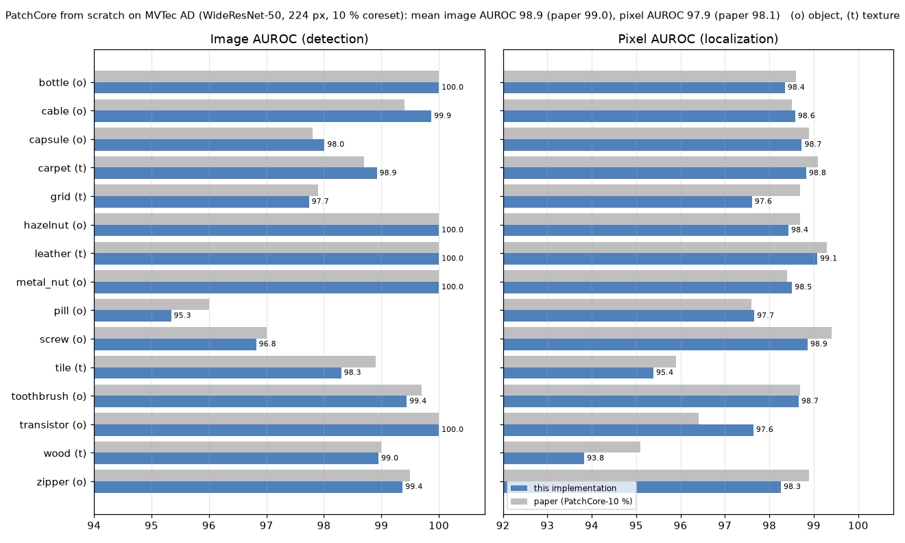
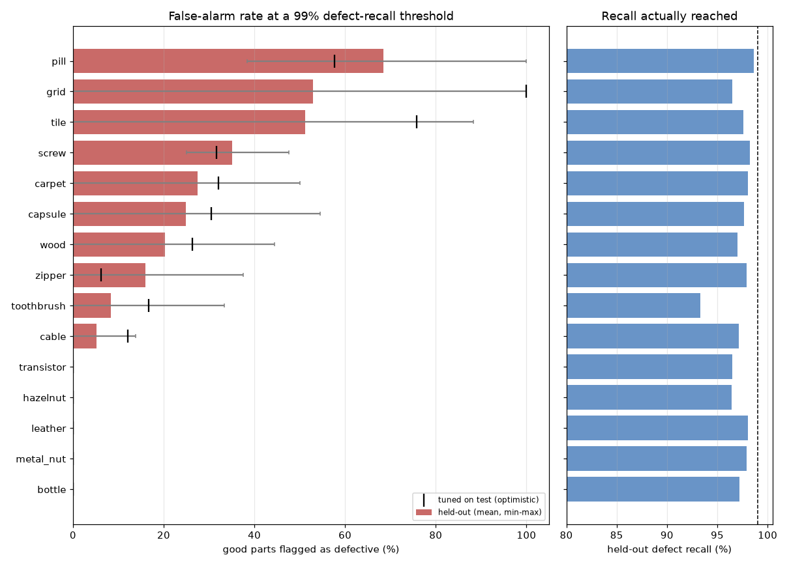
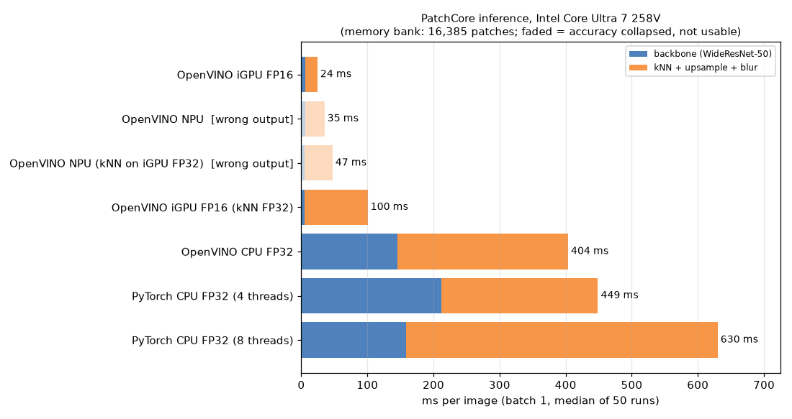

# 13 · Unsupervised Anomaly Detection (PatchCore from scratch)

Finds and localizes manufacturing defects **without ever seeing a defect during training**.
A from-scratch PyTorch implementation of **PatchCore** (Roth et al., *Towards Total Recall in
Industrial Anomaly Detection*, CVPR 2022), about 150 lines with no anomaly-detection library,
evaluated on all 15 categories of the MVTec AD benchmark on a laptop CPU.

**▶ Try it live:** [Hugging Face demo](https://huggingface.co/spaces/yandyassine/patchcore-defect-detection), running entirely in your browser (ONNX Runtime Web, WebGPU or WebAssembly; no server).
Model files and card: [yandyassine/patchcore-mvtec-ad](https://huggingface.co/yandyassine/patchcore-mvtec-ad).

> Example images and heatmaps are not shown: the dataset licence (MVTec AD, CC BY-NC-SA 4.0) does not allow
> redistribution. Every figure here is a chart of measured numbers.

## Results

### Accuracy on all 15 MVTec AD categories

| Category | Image AUROC | Pixel AUROC | Paper (image / pixel)* | Train / test (defective) | Fit (CPU) |
|---|---|---|---|---|---|
| bottle | 1.000 | 0.984 | 1.000 / 0.986 | 209 / 83 (63) | 14.6 min |
| cable | 0.999 | 0.986 | 0.994 / 0.985 | 224 / 150 (92) | 10.4 min |
| capsule | 0.980 | 0.987 | 0.978 / 0.989 | 219 / 132 (109) | 6.1 min |
| carpet | 0.989 | 0.988 | 0.987 / 0.991 | 280 / 117 (89) | 9.6 min |
| grid | 0.977 | 0.976 | 0.979 / 0.987 | 264 / 78 (57) | 5.2 min |
| hazelnut | 1.000 | 0.984 | 1.000 / 0.987 | 391 / 110 (70) | 9.1 min |
| leather | 1.000 | 0.991 | 1.000 / 0.993 | 245 / 124 (92) | 4.0 min |
| metal_nut | 1.000 | 0.985 | 1.000 / 0.984 | 220 / 115 (93) | 4.4 min |
| pill | 0.953 | 0.977 | 0.960 / 0.976 | 267 / 167 (141) | 6.2 min |
| screw | 0.968 | 0.989 | 0.970 / 0.994 | 320 / 160 (119) | 6.7 min |
| tile | 0.983 | 0.954 | 0.989 / 0.959 | 230 / 117 (84) | 4.2 min |
| toothbrush | 0.994 | 0.987 | 0.997 / 0.987 | 60 / 42 (30) | 1.1 min |
| transistor | 1.000 | 0.976 | 1.000 / 0.964 | 213 / 100 (40) | 3.3 min |
| wood | 0.990 | 0.938 | 0.990 / 0.951 | 247 / 79 (60) | 3.8 min |
| zipper | 0.994 | 0.983 | 0.995 / 0.989 | 240 / 151 (119) | 3.5 min |
| **mean** | **0.989** | **0.979** | **0.990 / 0.981** | 3,629 / 1,725 (1,258) | 1.5 h total |

\*PatchCore-10 % (WideResNet-50, 224 px) from the paper's supplementary Tables S1 and S2
([arXiv:2106.08265v2](https://arxiv.org/abs/2106.08265)), the exact configuration implemented here.

- **Image AUROC**: can it tell defective parts from good ones? 1.0 = perfect ranking.
- **Pixel AUROC**: does the heatmap light up the right pixels (compared with the ground-truth masks)?

**The from-scratch implementation matches the paper within 0.1 point on mean image AUROC (98.9 vs 99.0) and
0.2 point on mean pixel AUROC (97.9 vs 98.1).** Per category, image AUROC is within 0.7 point everywhere
(largest gaps: pill −0.7, tile −0.6). Pixel AUROC is lowest on the textures tile (95.4) and wood (93.8), as in the
paper, and our largest pixel gaps are wood (−1.3) and grid (−1.1), while transistor is 1.2 points *above* the
paper. Remaining differences most likely come from preprocessing details (resize / crop, the resolution at which
masks are scored: here 224 px center crops) and the random coreset projection; one run, seed 0.



### Operating threshold: false alarms at 99 % defect recall

AUROC says how well defects are *ranked*; a factory needs a *threshold* (flag the part or not). For each
category the threshold is chosen to catch 99 % of defects, and we report how many good parts it then flags.

**Protocol (no tuning on the reported numbers).** PatchCore trains on good images only, so the only labelled
defects are in the MVTec test set. Each category's test set is split in half, **stratified by defect type**
("good" is one type), with a fixed seed:
1. *calibration half*: threshold = the highest score that still flags ≥ 99 % of its defective images (with fewer
   than 100 defects per half, that is simply the lowest defect score);
2. *held-out half*: that threshold is applied unchanged, and recall and false-alarm rate are measured there.

The halves then swap roles, and this is repeated over 10 random splits (20 held-out evaluations per category,
every image held out 10 times). Code: [`threshold.py`](threshold.py); numbers:
[`docs/thresholds.json`](docs/thresholds.json).

| Category | Good / defective test images | Held-out defect recall | **Held-out false alarms** | Missed / false alarms per full test set | Tuned on test (optimistic) |
|---|---|---|---|---|---|
| bottle | 20 / 63 | 97.2 % (min 88 %) | **0.0 %** | 1.8 / 0.0 | 0.0 % |
| hazelnut | 40 / 70 | 96.4 % (min 80 %) | **0.0 %** | 2.5 / 0.0 | 0.0 % |
| leather | 32 / 92 | 98.0 % (min 89 %) | **0.0 %** | 1.8 / 0.0 | 0.0 % |
| metal_nut | 22 / 93 | 97.9 % (min 89 %) | **0.0 %** | 1.9 / 0.0 | 0.0 % |
| transistor | 60 / 40 | 96.5 % (min 85 %) | **0.0 %** | 1.4 / 0.0 | 0.0 % |
| cable | 58 / 92 | 97.2 % (min 85 %) | **5.2 %** | 2.6 / 3.0 | 12.1 % |
| toothbrush | 12 / 30 | 93.3 % (min 80 %) | **8.3 %** | 2.0 / 1.0 | 16.7 % |
| zipper | 32 / 119 | 97.9 % (min 89 %) | **15.9 %** | 2.5 / 5.1 | 6.2 % |
| wood | 19 / 60 | 97.0 % (min 87 %) | **20.3 %** | 1.8 / 3.9 | 26.3 % |
| capsule | 23 / 109 | 97.6 % (min 84 %) | **24.9 %** | 2.6 / 5.7 | 30.4 % |
| carpet | 28 / 89 | 98.1 % (min 93 %) | **27.5 %** | 1.7 / 7.7 | 32.1 % |
| screw | 41 / 119 | 98.2 % (min 92 %) | **35.1 %** | 2.1 / 14.4 | 31.7 % |
| tile | 33 / 84 | 97.6 % (min 90 %) | **51.2 %** | 2.0 / 16.9 | 75.8 % |
| grid | 21 / 57 | 96.5 % (min 86 %) | **52.9 %** | 2.0 / 11.1 | 100.0 % |
| pill | 26 / 141 | 98.6 % (min 94 %) | **68.5 %** | 2.0 / 17.8 | 57.7 % |
| **mean** | | **97.2 %** | **20.7 %** | | 25.9 % |



What this means:
- **5 of 15 categories reach the target with zero false alarms** (bottle, hazelnut, leather, metal_nut,
  transistor), and 2 more stay under 10 %. For those, PatchCore is deployable as is.
- **A 99 % recall promise costs a lot on the hard categories**: pill flags 69 % of good pills, grid and tile about
  half. These are the categories with the lowest image AUROC; at very high recall, a single subtle defect that
  scores like a good part drags the threshold down. Relaxing the target to 95 % recall (`--recall 0.95`) cuts the
  mean false-alarm rate from 20.7 % to 6.0 % (held-out recall 93.7 %).
- **The recall actually reached on unseen images is 97.2 %, not 99 %.** With 30–70 defects per calibration half,
  "99 %" means "catch every calibration defect", and roughly one unseen defect in 35 still scores lower. Reaching a
  true 99 % would need either a margin below the lowest calibration score or many more labelled defects.
- The "tuned on test" column (threshold picked on the full test set) is shown only to make the gap visible; it is
  not a result. It is not always lower: on grid, one defect scores below *every* good part, so a threshold that
  catches it flags 100 % of good grids.

### Desktop latency: PyTorch vs OpenVINO (CPU, Arc iGPU, NPU)

[`benchmark.py`](benchmark.py) converts the inference graph to OpenVINO IR in two parts, the backbone
(image → 784 × 1,536 patch features) and the kNN scorer (memory bank baked in, nearest-neighbor distance as one
matrix multiplication, then upsampling + blur), so each can run on its own device. Batch 1, model inference only
(image decoding/resizing excluded), median of 50 runs after 10 warm-up runs, bottle's 16,385-patch memory bank,
OpenVINO 2026.4. Every configuration is also re-scored on the full bottle, grid and screw test sets.

| Runtime | Device | Backbone | kNN + map | **Total / image** | vs PyTorch | Image AUROC bottle / grid / screw |
|---|---|---|---|---|---|---|
| PyTorch FP32 (4 threads) | CPU | 212 ms | 237 ms | **449 ms** | 1× | 1.000 / 0.977 / 0.968 |
| PyTorch FP32 (8 threads) | CPU | 158 ms | 472 ms | 630 ms | 0.7× | (same code) |
| OpenVINO FP32 | CPU | 145 ms | 265 ms | **404 ms** | 1.1× | 1.000 / 0.977 / 0.968 |
| OpenVINO FP16 backbone, FP32 kNN | Arc 140V iGPU | 4.4 ms | 78 ms | 100 ms | 4.5× | 1.000 / 0.977 / 0.968 |
| **OpenVINO FP16** | **Arc 140V iGPU** | **5.6 ms** | **12 ms** | **24 ms** | **18×** | **1.000 / 0.977 / 0.968** |
| OpenVINO (FP16) | AI Boost NPU | 6.0 ms | 28 ms | 35 ms | (13×) | **0.554 / 0.596 / 0.408: wrong output** |

(Totals include the copy between the two models. Pixel AUROC on the iGPU is also unchanged: 0.984 / 0.976 / 0.989.
Full numbers: [`docs/latency.json`](docs/latency.json).)



- **The Arc iGPU gives real time: 24 ms per image (~40 FPS) instead of 449 ms, with the same AUROC.** The backbone
  drops from ~150–210 ms to ~5 ms, so the bottleneck becomes the nearest-neighbor search (784 patches × 16k bank ×
  1,536 dims ≈ 39 GFLOP per image).
- **FP16 distances are fine.** I expected `|q|² + |b|² − 2 q·b` in FP16 to lose precision, so I also ran the kNN in
  FP32 on the iGPU: 4× slower (78 vs 12 ms) for no meaningful accuracy gain (grid image AUROC 0.9774 vs 0.9766, pixel AUROC
  0.9761 vs 0.9760).
- **On the CPU alone OpenVINO helps little** (1.1× here, 1.4× in an earlier run: 283 vs 389 ms): most of the time
  is the large kNN matrix product, which PyTorch already does with an optimized BLAS. Timings on this laptop
  vary ±30 % between runs because other jobs share it; the iGPU numbers were the most stable (24–32 ms).
- **The NPU compiles and runs fast, but computes the wrong features.** Its backbone output correlates only 0.76
  (layer 2) and 0.56 (layer 3) with the CPU's on the same input, so AUROC falls to chance level. The iGPU in FP16
  matches the CPU to 0.002. The first attempt didn't even compile on the NPU (it needs static input shapes; the
  compiler aborted the process). I didn't find the root cause (likely an NPU compiler issue with one of the
  backbone's layers); the NPU is not usable for this model as is.
- Before: the README's desktop number was ~390–570 ms per image in PyTorch (batch 8, including data loading).

## How it works

Defect data is rare and expensive in real factories, but images of *good* parts are plentiful.
PatchCore only needs those.

1. **Patch features**: each image goes through an ImageNet-pretrained WideResNet-50 (frozen, no
   training). Feature maps from layers 2 and 3 are concatenated: mid-level features that are local
   enough for small scratches and semantic enough to ignore pixel noise. Each position is averaged
   with its 3×3 neighborhood, giving one 1,536-d vector per 8×8-pixel patch (784 per image).
2. **Memory bank**: patch vectors from all good training images (47k–307k per category) are collected.
3. **Coreset subsampling**: greedy farthest-point sampling (on a random 128-d projection) keeps
   10 % of the patches while still covering the whole feature space. That makes the bank 10× smaller
   and nearest-neighbor search 10× faster, with almost no accuracy loss.
4. **Scoring**: each test patch's anomaly score is the distance to its nearest neighbor in the bank.
   A patch that looks like nothing seen on good parts scores high. The image score is the max patch
   score; the patch scores, upsampled and Gaussian-smoothed (σ = 4), form the heatmap.
5. **Decision**: a per-category threshold on the image score, calibrated on held-out labelled images
   (see above).

Code: [`patchcore.py`](patchcore.py) (the method) · [`run.py`](run.py) (data loading, evaluation) ·
[`threshold.py`](threshold.py) (operating point) · [`benchmark.py`](benchmark.py) (OpenVINO export + latency) ·
[`report.py`](report.py) (chart + table).

## Data

- **Source:** [MVTec AD](https://www.mvtec.com/company/research/datasets/mvtec-ad), license
  CC BY-NC-SA 4.0 (non-commercial). Downloaded from the Hugging Face mirror `foersben/mvtec-ad`
  (original folder layout + license), because the original per-category links returned 404.
- **Categories:** all 15 (10 objects, 5 textures): 3,629 good training images, 1,725 test images of which
  1,258 are defective (73 defect types), with pixel-level masks.
- **Location:** `../../cv-data/mvtec/<category>/` (not committed), 5.0 GB.

## Run it

```bash
.venv\Scripts\activate            # shared environment, from the repo root
cd 13-anomaly-detection-patchcore
python run.py                     # all 15 categories, resumable (skips finished ones; --force to redo)
python threshold.py               # operating thresholds at 99 % recall (--recall 0.95 for another target)
python report.py                  # docs/results_chart.png + the README table
python benchmark.py               # OpenVINO export + latency on CPU / iGPU / NPU + accuracy check
```

Get the data (≈ 5 GB for all 15 categories, loose PNG files, no archive to extract):

```bash
python -c "from huggingface_hub import snapshot_download as d; d('foersben/mvtec-ad', repo_type='dataset', local_dir='../../cv-data/mvtec', allow_patterns=['*/train/**','*/test/**','*/ground_truth/**','license.txt'])"
```

## Browser demo (no server)

The [live demo](https://huggingface.co/spaces/yandyassine/patchcore-defect-detection) runs the model on the
visitor's own device with ONNX Runtime Web (WebGPU when available, WebAssembly otherwise), so it is free to host
and uploaded photos never leave the browser. It covers bottle, metal_nut and grid.

- [`web/build.py`](web/build.py) exports two ONNX graphs: the backbone (image → 784 patch features), and one
  nearest-neighbor graph per category with the memory bank baked in, written as one matrix multiplication
  (`|q|² + |b|² − 2 q·b`). Weights are stored as float16 and cast back to float32 inside the graph: ~50 MB per
  file instead of ~100 MB, with float32 math. It picks each demo category's threshold as the best F1 on the
  test set (a convenience for the demo, tuned on test; the held-out protocol above is the honest number).
- [`web/validate.py`](web/validate.py) re-runs the full test set through the ONNX files: **image AUROC and F1
  are identical to PyTorch** (1.000 / 0.999 / 0.977; [`docs/onnx_validation.json`](docs/onnx_validation.json)).
- [`web/index.html`](web/index.html) is the whole demo page. In the browser, one image takes ~0.3 s with WebGPU
  and ~2 s with WebAssembly on one thread (laptop measurements).

```bash
python web/build.py && python web/validate.py     # writes to ../../cv-data/mvtec/web/
```

## What I learned / what didn't work

- **Reproducing a paper across a whole benchmark is the real test.** Three categories looked fine; all 15 show
  the same picture as the paper (objects ≈ solved, pill / screw / grid / tile hardest), within 0.1–0.2 point on
  the means.
- **AUROC ≥ 0.98 can still mean 50 % false alarms.** AUROC averages over all thresholds; a factory runs at one,
  at the extreme recall end where a single hard defect sets the threshold. Grid has 0.977 AUROC but needs to flag
  half the good parts to keep 97 % recall.
- **Small validation sets can't certify 99 %.** Calibrating on ~30–70 defects reaches ~97 % recall on unseen
  images. The honest way to promise 99 % is more labelled defects, not a cleverer formula.
- **Textures are harder to localize** (wood 93.8, tile 95.4 pixel AUROC): a defect patch can look locally like a
  *different* part of the normal texture, and the coarse 28×28 patch grid blurs thin cracks.
- **The coreset loop dominates fit time.** It is now written as one matrix-vector product per step
  (`|a|² + |b|² − 2 a·b`) instead of a `cdist` call: on 100k random 1,536-d patches it is 5.9× faster
  (2.9 s vs 17.1 s for 1,000 picks) and selects exactly the same patches. It is still a sequential loop of
  5k–31k steps, so it remains most of each fit (12–534 s).
  The ~1.5 h total fit for all 15 categories was measured while other jobs shared the laptop, so fit times are
  indicative only, and the `ms_per_test_image` field of `results.json` (which includes data loading, and a laptop
  sleep during carpet) is not a latency measurement; `benchmark.py` is.

## Next steps

- Calibrate the threshold with a safety margin (or a conformal bound) so the 99 % promise holds on unseen parts,
  and report it against more defect samples (e.g. MVTec AD 2 or VisA).
- Close the pixel-AUROC gap on textures (larger feature maps or higher input resolution).
- INT8 quantization of the backbone (NNCF), as in project 19, and find why the NPU computes wrong features
  (bisect the backbone layer by layer on the NPU).

## Tech stack

Python · PyTorch · torchvision (WideResNet-50) · scikit-learn (AUROC) · OpenVINO 2026.4 · Matplotlib

## Run with Docker

CPU-only image (`python:3.10-slim` + CPU PyTorch). The dataset is not baked in: the `cv-data` folder is mounted
at `/data`, and the WideResNet-50 weights are cached there on first run. Commands from this folder:

```bash
docker build -f Dockerfile -t cv-patchcore ..          # build context = repo root (needs common/)
docker run --rm \
  -v "$(pwd)/../../cv-data:/data" \
  -v "$(pwd)/../../cv-data/mvtec/outputs/docker-docs:/app/13-anomaly-detection-patchcore/docs" \
  cv-patchcore --categories bottle
```

The second mount collects `results.json` outside the repo (so the committed `docs/` isn't overwritten). On
Windows PowerShell, use `${PWD}` instead of `$(pwd)`.
