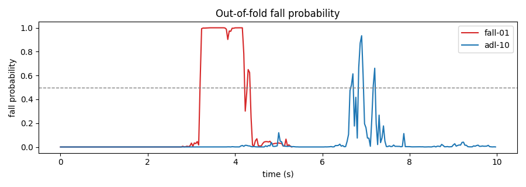
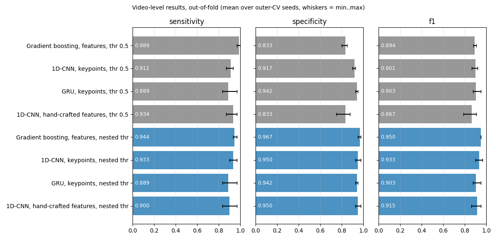

# 15 · Fall Detection from Video

Detects when a person **falls** in a video and raises an alarm, while **not** alarming when
they sit, crouch or lie down on purpose. Each frame is reduced to a body skeleton (YOLO11n-pose),
the skeleton to posture and motion features, and a classifier decides whether a fall is happening.

> Example images not shown: the dataset licence (UR Fall Detection, research use only) does not allow redistribution; see the dataset page.

## Results

UR Fall Detection dataset, front camera: **30 falls and 40 daily activities**, 16 of which include
lying down on purpose (the hard negatives). Scored per video: did a fall raise an alarm
(sensitivity), and did a non-fall stay quiet (specificity)?

| Detector | Sensitivity (falls caught) | Specificity (no false alarm) | F1 | Median alarm latency |
|---|---|---|---|---|
| Hand-written rules | 80.0 % (24/30) | 95.0 % (38/40) | 0.857 | 0.95 s |
| Learned (gradient-boosted trees, 5-fold CV), threshold fixed at 0.5 | 100 % (30/30) | 80.0 % (32/40) | 0.882 | 0.60 s |
| **Learned, threshold chosen by nested CV** | **96.7 %** (29/30) | **95.0 %** (38/40) | **0.951** | 0.70 s |

Same split for all three rows (5 folds grouped by video, shuffling seed 0); F1 counts a fall as the positive class.

### Choosing the alarm threshold without peeking (nested CV)

The first version of this project reported the threshold sweep below and noted that 0.9 looked best,
but 0.9 was picked *after* seeing the test results. The threshold is now chosen honestly: inside each
training fold, a second grouped 4-fold CV produces validation probabilities for the training videos
only, the threshold with the best video-level F1 on them is kept (median of the tied values, grid
0.30-0.95), and only then is it applied to the held-out fold. To see how much the numbers depend on
the particular split, the whole outer CV is repeated with 5 shuffling seeds:

| Protocol (gradient-boosted trees) | Sensitivity | Specificity | F1 |
|---|---|---|---|
| Fixed threshold 0.5 (original protocol) | 99.3 % (96.7-100) | 83.5 % (80.0-85.0) | 0.898 (0.882-0.909) |
| **Nested CV threshold** (honest) | **93.3 %** (90.0-96.7) | **96.5 %** (95.0-97.5) | **0.943** (0.931-0.951) |
| Best threshold picked on the test results (optimistic, reference only) | 95.3 % (90.0-100) | 97.0 % (95.0-100) | 0.956 (0.933-0.983) |

*Mean over 5 outer-CV seeds, (min-max) in brackets. 30 falls, 40 daily activities per seed.*

- The nested thresholds land between 0.65 and 0.95 (most often 0.9-0.95): the inner folds agree that
  0.5 is too eager. The honest F1 (0.943) is only 0.013 below the peeked one (0.956), so the earlier
  "~97 % caught, ~0 false alarms at 0.9" was optimistic but not by much.
- The trade-off is real: compared with 0.5, the nested threshold removes about 5 of the 6-8 false
  alarms per run but misses 1-3 of the 30 falls (fall-29 and fall-25 are missed most often), and the
  alarm comes 0.1-0.2 s later.
- `evaluate.py` applies the same rule to the final model: a grouped 5-fold CV over all 70 videos
  picks **0.90**, which is saved in `fall_model.joblib` and used by `detect.py`.

The operating curve on the seed-0 out-of-fold probabilities, for reference (descriptive, not a selection):

| Alarm threshold | Sensitivity | Specificity | F1 | Median latency |
|---|---|---|---|---|
| 0.5 | 100 % | 80.0 % | 0.882 | 0.6 s |
| 0.7 | 96.7 % | 87.5 % | 0.906 | 0.7 s |
| 0.8 | 96.7 % | 92.5 % | 0.935 | 0.7 s |
| 0.9 | 96.7 % | 100 % | 0.983 | 0.7 s |



*A fall (red) drives the probability to ~1.0 and keeps it there. Lying down on purpose (blue) spikes
briefly but doesn't stay above the threshold for 10 consecutive frames (0.33 s), so no alarm.*

### Temporal models on raw keypoints (1D-CNN, GRU): they don't beat the trees

Instead of the 16 hand-crafted window features, a small network reads the raw skeleton sequence
([`temporal_model.py`](temporal_model.py), [`temporal.py`](temporal.py)): per frame, the 17 keypoints
(x, y, confidence), the box, a detection flag and their velocities (94 numbers), standardised on the
training fold. Two causal architectures (they only see the past, so they could run online like the
trees): a **1D-CNN** (dilated causal convolutions, 32 channels, 2.1 s receptive field, ~19 k
parameters) and a **GRU** (48 units, ~19 k parameters). Trained from scratch on CPU with weighted BCE on random 5 s
windows, mirrored copies of the training videos and input noise, 600 steps. Evaluated with **exactly the
same protocol** as the trees: same outer folds per seed, same nested threshold choice, same alarm rule.

| Model (outer seeds 0, 1, 2) | Sensitivity | Specificity | F1 | Median latency |
|---|---|---|---|---|
| **Gradient-boosted trees, hand-crafted features** | **94.4 %** (93.3-96.7) | **96.7 %** (95.0-97.5) | **0.950** (0.949-0.951) | 0.72 s |
| 1D-CNN, raw keypoints | 93.3 % (90.0-96.7) | 95.0 % (92.5-97.5) | 0.933 (0.900-0.967) | **0.33 s** |
| GRU, raw keypoints | 88.9 % (83.3-96.7) | 94.2 % (92.5-95.0) | 0.903 (0.877-0.951) | 0.38 s |
| 1D-CNN, the same 16 hand-crafted features as the trees | 90.0 % (83.3-96.7) | 95.0 % (92.5-97.5) | 0.915 (0.862-0.951) | 0.47 s |

*Nested-CV threshold for every row; mean over 3 outer seeds, (min-max) in brackets; latency = mean of the per-seed medians.*



*Grey: threshold fixed at 0.5. Blue: threshold chosen by nested CV. Whiskers: min-max over the 3 outer seeds.*

- **The trees stay best on average and are far more stable** (F1 0.949-0.951 across splits vs
  0.900-0.967 for the 1D-CNN). With 56 training videos per fold, of which 24 falls, a network that
  must discover "fast descent then horizontal" from raw coordinates has little to learn from; the
  hand-crafted features hand it that knowledge. The 1D-CNN did win on one split (0.967 vs 0.949), so
  "worse" here means "worse on average and noisier", not "always worse".
- **The networks raise the alarm about twice as fast** (median ~0.33 s after the labelled onset vs
  ~0.7 s): they react to the first frames of the drop instead of waiting for the posture features to
  turn horizontal. For a real alarm that matters less than missing a fall, but it is a genuine strength.
- **They make different mistakes.** The trees' false alarms are adl-16, adl-32 and adl-39;
  the networks' are adl-26 and adl-37, and both networks miss fall-13 and fall-07 in most runs. That
  makes an ensemble a natural next step (not tried here).
- **It isn't only the inputs.** Fed the trees' own 16 features, the same 1D-CNN does *worse* than on
  raw keypoints (F1 0.915, 0.862-0.951): with this little data, gradient-boosted trees simply fit
  tabular features more reliably than a network trained from scratch.
- **The GRU's probabilities are almost binary**: its nested threshold changes nothing compared with 0.5
  (identical results on all 3 seeds), so threshold tuning can't trade its misses for false alarms.
- **Cost**: one network fit took 17 s on an idle CPU and up to 2 min while the laptop was busy, ~25 fits
  per seed with the inner CV (up to ~2.5 h for 3 seeds); the trees train in seconds.

## How it works

1. **Pose**: YOLO11n-pose finds the largest person in each frame and their 17 body keypoints.
2. **Features** ([`fall.py`](fall.py)), per frame:
   - *Posture*: torso angle from vertical (shoulders vs hips), bounding-box aspect ratio, head/hip height.
   - *Dynamics*: how fast the head and box top moved down, how fast the torso tilted, and the
     maximum of those over the last 1.5 s; current height relative to the last 2 s.
3. **Rule baseline**: alarm if the body is horizontal (torso > 55° or box wider than tall)
   AND a fast descent happened in the last 1.5 s, for **5** consecutive frames (the learned model
   below uses 10, so the comparison isn't perfectly like-for-like: the rule is given the faster trigger).
4. **Learned model**: gradient-boosted trees predict, per frame, "a fall is happening or just
   happened". Training target = the fall plus the 2 s after it began; every frame of a daily
   activity is negative, *including deliberate lying down*.
5. **Alarm**: probability above the threshold for **10 consecutive frames** (0.33 s). This filters
   one-frame spikes. The threshold is chosen by an inner cross-validation on training videos only
   ([`protocol.py`](protocol.py): alarm rule, video-level scoring and threshold choice, shared by all models).
6. **Evaluation**: 5-fold cross-validation **grouped by video**, so a video's frames are never split
   between training and testing (that would leak and inflate the scores), repeated with 5 shuffling seeds.

## Data

- **UR Fall Detection Dataset** (Kwolek & Kepski, 2014), University of Rzeszów:
  [fenix.ur.edu.pl/~mkepski/ds/uf.html](http://fenix.ur.edu.pl/~mkepski/ds/uf.html). Research use; cite the paper.
  Videos are depth | RGB side by side (640×240); only the RGB half is used. Per-frame labels:
  not lying / falling / lying.
- **Location:** `../../cv-data/fall/` (not committed): the two label files `urfall-cam0-falls.csv` and
  `urfall-cam0-adls.csv`, and the 70 `*-cam0.mp4` videos in `videos/` (94 MB, needed only until the
  skeletons are cached in `../../cv-data/fall/outputs/poses/`; all later runs read the cache).
- **Reproduced after a data loss (2026-10-31):** the original videos and cached skeletons were lost with a
  USB key. Re-downloading the 70 videos and re-extracting the skeletons with the same scripts gave
  **exactly** the published numbers (same 6 missed falls for the rules, same 8 false-alarm videos and the
  same threshold sweep for the learned model).

## Run it

```bash
.venv\Scripts\activate            # shared environment, from the repo root
cd 15-fall-detection
python evaluate.py                                  # poses (first run 10 min to 1 h on CPU), nested CV x5 seeds, figures, final model
python evaluate.py --seeds 0                        # only the original split (faster)
python temporal.py                                  # 1D-CNN + GRU on raw keypoints, same nested protocol (20 min to 2.5 h per model, CPU)
python temporal.py --arch tcn --inputs features     # 1D-CNN on the hand-crafted features instead
python detect.py my_video.mp4                       # any video → annotated copy + alarm time
python detect.py 0                                  # live webcam (q to quit)
```

## What I learned / what didn't work

- **Rules are conservative, learning is eager.** The fixed thresholds miss 6 falls (fall-12, 13,
  16, 18, 22, 24) whose descent or final posture stays under the hand-picked limits, while the learned
  model catches every fall but over-fires on 8 daily activities at threshold 0.5. The sweep shows
  those false alarms peak between 0.5 and 0.9, so a higher threshold removes them.
- **Peeking at the test set to pick a threshold cost little here, but it did cost something.** Chosen
  honestly (nested CV), the threshold gives F1 0.943 instead of 0.956, and sensitivity drops from ~97 %
  to ~93 %: with 30 falls, one video is 3.3 points, so every threshold decision is coarse.
- **Deep learning didn't win on 70 videos.** The 1D-CNN and GRU on raw keypoints land 0.02-0.05 F1
  below the trees and swing much more from one split to the next. Their one clear advantage is speed:
  they fire ~0.35 s earlier. Repeating the CV with several seeds was essential: on a single split the
  ranking can flip.
- **Dynamics are what separate a fall from lying down.** Posture alone can't: 16 of the 40 daily
  activities end horizontal. The features that look back 1.5 s carry the distinction.
- **30 + 40 videos is small**, recorded indoors by a few actors performing *simulated* falls. Real falls by elderly people are slower and often partial; this needs validation on
  real-world data before anyone relies on it.
- **The webcam mode** scores a rolling 3-second window. It runs on CPU but wasn't tested on live
  falls (for obvious reasons).

## Next steps

- Ensemble the trees and the 1D-CNN: they miss different videos, and the network fires earlier.
- More and more realistic data (other fall datasets, real falls) before any network can be expected to
  beat the hand-crafted features.
- The second camera (cam1) was **not** added: UR Fall provides it for the 30 falls only, not for the 40
  daily activities, so a cam1 model could not be scored on false alarms. The depth stream (left half of
  each video) is only a lossy 8-bit video rendering here; using real depth would need the raw depth PNG
  archives (45 MB for fall-01 alone, several GB for the 70 sequences), too much for this machine's disk.

## Tech stack

Python · Ultralytics YOLO11-pose · scikit-learn (HistGradientBoosting, StratifiedGroupKFold) · PyTorch (1D-CNN, GRU) · OpenCV · NumPy

## Run with Docker

CPU-only image (`python:3.10-slim` + CPU PyTorch + Ultralytics) for `detect.py` on a video file. The
`cv-data` folder is mounted at `/data`; it must already contain `fall/outputs/fall_model.joblib` (from
`python evaluate.py`). The pose model is downloaded into the same folder on first use. Commands from this folder:

```bash
docker build -f Dockerfile -t cv-fall ..                # build context = repo root (needs common/)
docker run --rm -v "$(pwd)/../../cv-data:/data" cv-fall \
  /data/fall/videos/fall-01-cam0.mp4 --ur-fall --out /data/fall/outputs/detected_docker.mp4
```

Any other video works too: put it under `../../cv-data/` and pass its `/data/...` path (drop `--ur-fall`
for normal videos). Webcam mode isn't supported in the container. On Windows PowerShell, use `${PWD}`
instead of `$(pwd)`.
