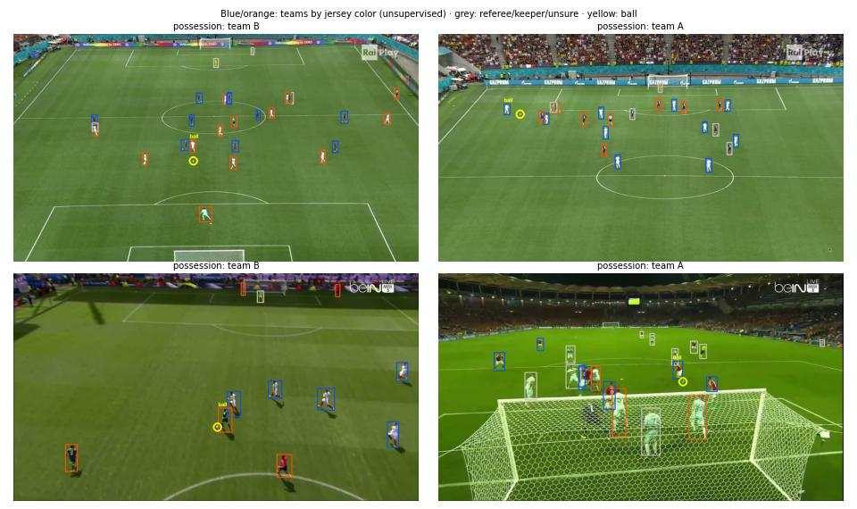

# 20 · Football Analytics (capstone)

Detects **players and the ball** in broadcast football frames, splits players into **two teams by jersey
color without any team labels**, and decides **which team has the ball**. A YOLO11n detector fine-tuned
on a laptop CPU, plus unsupervised color clustering and simple geometry: the pieces of a match-analytics
pipeline, each measured where ground truth exists.



*Blue / orange: teams found by jersey color (no labels used). Grey: referee, goalkeeper or unsure.
Yellow circle: ball. Title: team in possession (nearest player to the ball).*

## Results

Test split: 130 broadcast frames (1280×720).

### Detection

| Class | AP50 | AP50-95 |
|---|---|---|
| **player** | **0.980** | 0.709 |
| ball | 0.438 | 0.214 |
| mean | 0.709 | 0.461 |

Inference: 60 ms per frame on CPU (960 px input). Training: 859 frames, 15 epochs, ~2.5 h on CPU.

**Players are essentially solved; the ball is the hard part**: it's a few pixels wide, often blurred
or hidden by players, and appears in the training data ~17× less often than players (864 vs 15,096 boxes).

### Team assignment (unsupervised)

No team labels exist in the dataset, so this is measured indirectly:

| Metric | Value |
|---|---|
| Frames where two teams were found | 121 / 130 |
| Mean silhouette score of the two color clusters | **0.80** (range −1 to 1; > 0.7 = clearly separated) |
| Players set aside as "other" (referee, keeper, unsure) | 18.5 % |

### Ball possession

A team is assigned possession when the ball is detected and a player's feet are within 1.5 player
heights of it: **41 of 130 frames**. The bottleneck is ball detection, not the possession rule.

## How it works

1. **Detection** ([`train.py`](train.py)): YOLO11n from COCO weights, fine-tuned at **960 px** (instead of
   640) so the ball stays more than a couple of pixels wide.
2. **Jersey color** ([`analytics.py`](analytics.py)): for each player, the shirt area (upper-middle of the
   box) is converted to Lab color; **grass-green pixels are masked out** so the pitch doesn't dominate.
3. **Teams**: k-means with 2 clusters on those colors. Players far from both cluster centers (> 2.5× the
   median distance) are labeled "other": typically the referee and goalkeepers, who wear different colors.
4. **Possession**: the player whose feet (bottom-center of the box) are closest to the ball, if close
   enough, gives the possessing team.

## Data

- **Football players & ball detection** (Roboflow, Hugging Face mirror `keremberke/football-object-detection`,
  CC BY 4.0): 859 / 243 / 130 train / valid / test broadcast frames, classes `football` and `player`.
- **Location:** `../../cv-data/football/` (not committed).

## Run it

```bash
.venv\Scripts\activate            # shared environment, from the repo root
cd 20-football-analytics
python prepare.py                 # zips → YOLO layout
python train.py --epochs 15       # ~2.5 h on CPU; --resume continues an interrupted run
python evaluate.py                # detection mAP, team clustering, possession, figure
```

## What I learned / what didn't work

- **Small objects decide the score.** Player AP50 0.98 vs ball 0.44. Higher resolution (1280 px), a
  ball-specific detector, or tracking the ball between frames (it moves smoothly) are the standard fixes.
- **Unsupervised team split works well on clear kits** (silhouette 0.80), but team "A" and "B" are
  assigned **per frame**: the same team can be A in one frame and B in the next. A real system fits the
  team colors once per match, or tracks players across frames.
- **No tactical (top-down) map.** Mapping players onto a 2D pitch needs the pitch geometry in each frame
  (keypoints such as penalty-box corners), and this dataset has no such labels. Project 08 shows the
  homography technique on a fixed traffic camera; a broadcast camera moves, so it needs a learned pitch
  keypoint detector, the main missing piece of this capstone.
- **Single frames, not video.** Possession and team stats over time need tracking (project 08's ByteTrack)
  on match footage; this dataset is a set of independent frames.

## Next steps

- Pitch keypoint detection → homography → tactical map with player positions and distances run.
- Track players and ball across frames (ByteTrack) for possession percentages and passes.
- Fix team colors per match (fit on the first frames) so team identities stay stable.

## Tech stack

Python · Ultralytics YOLO11 · OpenCV (Lab color, masking) · scikit-learn (k-means, silhouette) · NumPy · Matplotlib
