# 20 · Football Analytics (capstone)

Detects **players and the ball** in broadcast football frames, splits players into **two teams by jersey
color without any team labels**, and decides **which team has the ball**. A YOLO11n detector fine-tuned
on a laptop CPU, plus unsupervised color clustering and simple geometry: the pieces of a match-analytics
pipeline, each measured where ground truth exists.

> Example images not shown: the dataset licence (broadcast footage, copyright of the broadcasters) does not allow redistribution; see the dataset page.

*Blue / orange: teams found by jersey color (no labels used). Grey: referee, goalkeeper or unsure.
Yellow circle: ball. Title: team in possession (nearest player to the ball).*

## Results

Test split: 130 broadcast frames (1280×720).

### Detection

| Class | AP50 | AP50-95 |
|---|---|---|
| **player** | **0.980** | 0.709 |
| ball | 0.438 | 0.214 |
| mean | 0.709 | 0.461 |

Inference: 60 ms per frame on CPU (960 px input). Training: 859 frames, 15 epochs, ~2.5 h on CPU.

**Players are essentially solved; the ball is the hard part**: it's a few pixels wide, often blurred
or hidden by players, and appears in the training data ~17× less often than players (864 vs 15,096 boxes).

### Team assignment (unsupervised)

No team labels exist in the dataset, so this is measured indirectly:

| Metric | Value |
|---|---|
| Frames where two teams were found | 121 / 130 |
| Mean silhouette score of the two color clusters | **0.80** (range −1 to 1; > 0.7 = clearly separated) |
| Players set aside as "other" (referee, keeper, unsure) | 18.5 % |

### Ball possession

A team is assigned possession when the ball is detected and a player's feet are within 1.5 player
heights of it: **41 of 130 frames**. The bottleneck is ball detection, not the possession rule.

### Tactical map: from the broadcast view to the pitch

*Tactical-map figure (broadcast frames + top-down view) not shown: the frames are broadcast footage owned by the broadcasters.*

A second model finds **32 pitch landmarks** (corners, penalty and goal boxes, halfway line, centre circle) in
each frame; any 4 or more give a **homography** from the image to the pitch, and each player's feet are projected
onto a top-down map. Held-out test frames (24, never used for training or tuning):

| Metric | Value |
|---|---|
| Frames where a homography could be built | **24 / 24** |
| Landmark error (1920 px wide frames) | median **21 px**, 90th percentile 50 px |
| Position error on the pitch | median **2.5 m**, 90th percentile 6.2 m |
| Same measurement using the *human-labeled* landmarks (floor) | median 0.8 m, 90th percentile 1.8 m |

The position error is measured by building the homography from the *predicted* landmarks, projecting the
*labeled* landmark pixels with it, and comparing with where those landmarks really are on the pitch. The settings
(keep landmarks with confidence ≥ 0.3, RANSAC tolerance 1.5 m) were chosen on the 30 validation frames; picking
them on the test frames would have reported a slightly better, dishonest number.

## v2 · Stage S4 statistics engine

v2 turns this project into a match-analytics system in six stages (design:
[`docs/superpowers/specs/2026-10-24-football-v2-match-analytics-design.md`](../docs/superpowers/specs/2026-10-24-football-v2-match-analytics-design.md)).
Stage S4 is the **statistics engine** ([`stats/`](stats/)): pure Python on pitch coordinates, independent of the
tracking provider. Input = per-frame player positions in metres + team per player + ball position. It is built and
validated *before* the video pipeline (S1–S3) exists, on public data with ground truth, so that we know in advance
which statistics our tracking errors will break.

| Statistic | Method ([`stats/`](stats/)) |
|---|---|
| Distance, speed, sprints | Savitzky–Golay derivative (1 s window, NumPy only), speed capped at 12 m/s, sprint = > 7 m/s for ≥ 1 s |
| Possession % | nearest player within a control radius; the team changes only after 5 control frames in a row (hysteresis) |
| Passes, pass network | control by A → (ball in flight) → control by team-mate B; control runs shorter than N frames ignored; `networkx` graph |
| Formation | average outfield positions in the attacking direction, standardised, Hungarian match to 4-4-2, 4-3-3, 4-2-3-1, 3-5-2, 5-3-2 |
| Compactness, defensive line | convex-hull area of the 10 outfield players; depth of the deepest outfield player |
| PPDA-style pressing | opponent passes in their own 60 % per possession regain in that zone (also computed from event data, for comparison) |

### Validation on Metrica Sports tracking (2 matches, 25 Hz, with event data)

**Pass detection** against the Metrica PASS events (start within 1 s, same passer *and* receiver). Control radius
and minimum control time were tuned on game 1 only; game 2 is held out.

| Match | Precision | Recall | **F1** |
|---|---|---|---|
| Game 1 (tuning) | 0.946 | 0.905 | 0.925 |
| **Game 2 (held out)** | **0.959** | **0.900** | **0.929** (team-level only: 0.937) |

Target was F1 ≥ 0.7 on clean tracks: met. Tuned setting: 0.5 m control radius, 2 frames of control (the edge of
the searched grid; Metrica's ball positions sit very close to the player's feet, which broadcast tracking won't).

Clean full-match values (sanity check): 8,980–9,550 m per player per 90 min, possession 52.8 % / 52.5 % for the
home sides, 764 / 905 passes detected vs 799 / 964 in the events. PPDA-style pressing from tracking vs from events,
per team and half: 3.9 vs 4.1, 4.1 vs 3.7, 7.2 vs 5.6, 8.7 vs 7.9, 5.7 vs 5.9, 6.6 vs 7.5, 8.9 vs 5.2, 5.2 vs 8.0:
same scale, but single halves can be off by up to 4 because a half has only 11–31 regains. Formations found per half
are 4-2-3-1, 3-5-2, 4-4-2, 4-3-3, 5-3-2 (Metrica gives no formation labels, so these are not scored). A few
Metrica frames contain glitches (single-frame jumps of 100+ m/s); the 12 m/s cap is what keeps them out of the
distances.

### What our tracking errors will do to the statistics (noise-injection ablation)

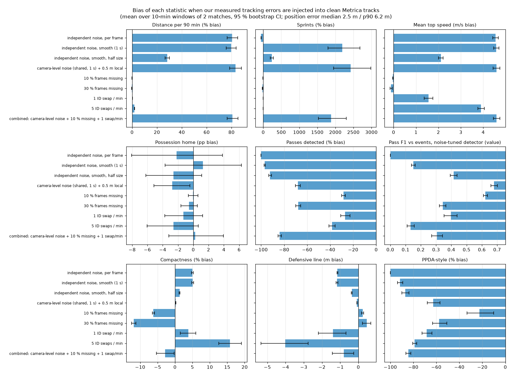

*Each 10-minute window of the two matches (20 windows, 2 noise draws each) is corrupted, then every statistic is
compared with the same window's clean value. Bars: mean bias; whiskers: 95 % bootstrap CI over windows.*

The errors injected are the ones measured in v1: **position error median 2.5 m / p90 6.2 m** (log-normal-scaled
2-D Gaussian fitted to those two numbers), changing every frame or smoothly (1 s), either **independent per object**
(pessimistic) or **shared by everything in the frame** (one camera model, + 0.5 m independent; closer to a
homography error); plus missing frames (10 %, 30 %, in ~1 s gaps) and ID swaps between neighbouring players
(1 or 5 per minute).

| Statistic | Camera-level noise only | 10 % missing | 1 ID swap / min | **Combined** (all three) |
|---|---|---|---|---|
| Distance per 90 min | **+83 %** [78, 88] | +0.0 % | +0.4 % | **+81 %** [77, 85] |
| Sprints | +2,400 % | −7 % | 0 % | +1,900 % |
| Mean top speed | +4.6 m/s | 0.0 | +1.6 m/s | +4.6 m/s |
| Possession (home) | −2.8 pp [−5.2, −0.5] | 0.0 pp | −1.3 pp | **+0.2 pp** [−3.2, 3.9] |
| Pass F1 (detector re-tuned for noise) | 0.68 | 0.62 | 0.40 | **0.31** [0.27, 0.34] |
| Formation same as clean | 100 % | 96 % | 49 % | 39 % |
| Compactness | +0.2 % | −6 % | +4 % | −3 % |
| Defensive line | −0.1 m | +0.2 m | −1.4 m | −0.8 m |
| PPDA-style | −63 % | −22 % | −68 % | −84 % |

What this says, before any video is processed:

- **Robust:** possession % (within ±3 pp in every condition), compactness and defensive-line height (a few % /
  about 1 m), and formation under position noise alone (91–100 % agreement).
- **Broken by v1-level position error:** distance, speed and sprints. A 2.5 m error that moves within a second
  *is* 2–3 m/s of fake running. The sweep in `results_stats.json` (`camera_noise_sweep`) gives S3 its target:
  with the error varying over **10 s** instead of 1 s, the distance bias drops from +87 % to **+2.8 %** (2.5 m
  error) and to +0.9 % at 1.25 m; at 3 s it is +20 % / +5.8 %. So S3's homography smoothing matters more than
  the raw accuracy.
- **Broken by identity errors:** formation (a swap moves a player's average position), passes with the right
  passer/receiver, PPDA (needs regains *and* passes). ID swaps also accumulate: over a full match (no re-ID
  correction), pass F1 under the combined errors falls to **0.09** (0.32 at team level). S1–S2 re-identification
  is a precondition for player-level pass statistics.
- Missing frames mostly cost *recall* (passes −28 % at 10 % missing), not bias in the per-player physical stats,
  because gaps under 1 s are interpolated.

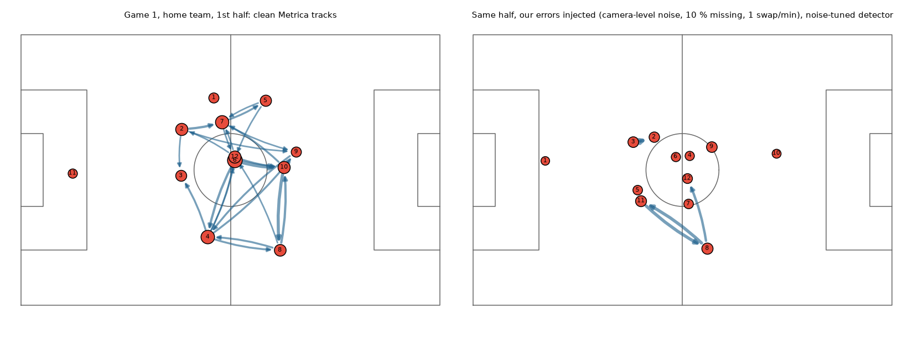

*Left: pass network of the home team (game 1, first half) from clean tracks; arrows = ≥ 3 passes, node size = passes
made, node = average position while in possession. Right: the same half after injecting the combined errors: ID
swaps scramble average positions and most links disappear.*

### Expected goals (xG) on StatsBomb open data


**15,308 shots** from 597 matches (14 men's competition-seasons, 2018–2024, incl. World Cups 2018/2022, Euros
2020/2024, Bundesliga 2023/24, La Liga, Ligue 1, MLS, ISL, AFCON, Copa América). Split **by match**: 3,080 test
shots from 120 matches never seen in training. Features: distance and angle to goal, body part / header, shot type
(open play, free kick, penalty, corner), play pattern, first-time, under pressure, and from the shot's freeze frame
(available for 97 % of shots): defenders in the shooting cone, goalkeeper in the cone, goalkeeper distance, nearest
defender distance.

| Model (held-out test) | Log-loss ↓ | Brier ↓ | ROC AUC |
|---|---|---|---|
| Base rate (11.7 % goals) | 0.354 | 0.101 | 0.500 |
| **Logistic regression** | **0.271** | **0.0773** | 0.819 |
| Gradient boosting | 0.273 | 0.0778 | 0.817 |
| StatsBomb's own xG | 0.270 | 0.0773 | 0.823 |

5-fold grouped cross-validation: logistic regression 0.278 ± 0.007 vs StatsBomb 0.276. Without penalties: 0.263
vs 0.259. Total xG on the test shots: 364 (ours) vs 357 (StatsBomb) for 350 goals.

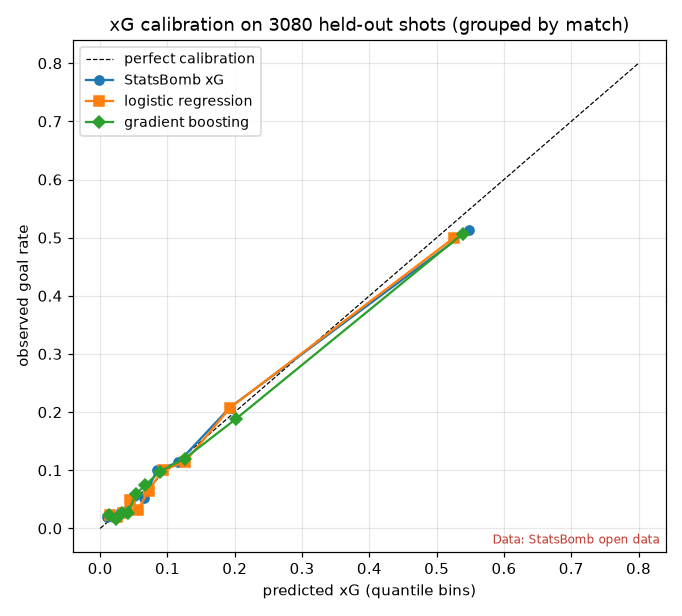

A simple, well-calibrated logistic regression on geometry + freeze-frame features lands within 0.001–0.002
log-loss of StatsBomb's commercial model; gradient boosting doesn't beat it on 12 k training shots. StatsBomb's
model sees things we don't (e.g. the ball's height), and it may have been trained on some of these matches, so the
comparison flatters it if anything.

### Run stage S4

```bash
cd 20-football-analytics
python -m stats.download_data      # Metrica games 1–2 (~160 MB) + StatsBomb shots (a few minutes, keeps only shots.csv)
python -m stats.validate_metrica   # pass F1, clean stats, noise ablation, figures (~6 min on CPU)
python -m stats.xg                 # xG models + calibration figure (~30 s)
```

All numbers are in [`docs/results_stats.json`](docs/results_stats.json). Unit tests: `tests/test_20_stats.py`
(speed/sprints, possession hysteresis, passes on synthetic plays, formation matching, the noise model).

**Remaining v2 stages:** S1 tracking (SoccerNet-Tracking HOTA), S2 team/jersey identity, S3 calibration
smoothing + ball (→ GS-HOTA), S5 action spotting + replays, S6 OpenVINO, demo video and match report.

## v3 · AI coach (phase 1: engine, models, evaluation)

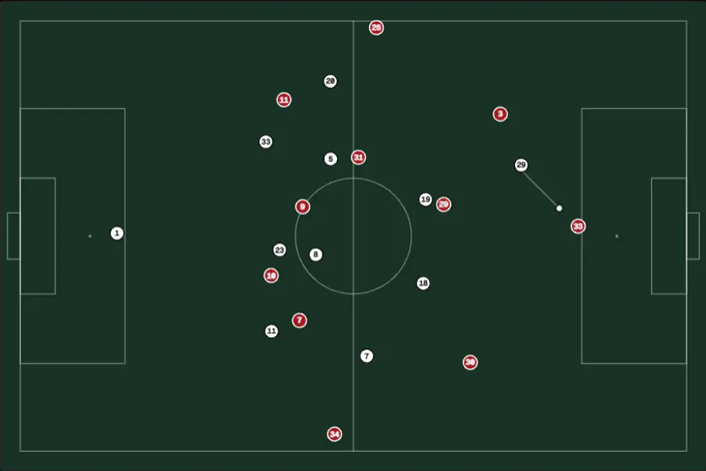

*Try it: [yandouziyassine.github.io/demos/football](https://yandouziyassine.github.io/demos/football/) (pause, ask
the coach, follow or refuse; 2D or 3D). Own rendering of Bundesliga tracking data (Bassek et al. 2025, DFL / Sportec
Solutions, CC BY 4.0).*

**What it does.** Give it one tracking frame (22 players + ball, in metres) and it ranks what the player on the ball
can do: a pass to each teammate, a carry in five directions, or a shot. Each option comes with the chance that it
works and what it is worth in **expected goals** (xG), counting the cost of losing the ball. This engine will run the
website's replay ("pause the match and ask the coach") and, later, the live camera mode. Design:
[`docs/superpowers/specs/2026-11-01-football-ai-coach-design.md`](../docs/superpowers/specs/2026-11-01-football-ai-coach-design.md).

**Data.** 7 full Bundesliga 2022/23 matches: optical tracking of every player and the ball at 25 fps plus the
official events (Bassek et al. 2025, *Scientific Data*, [DOI 10.1038/s41597-025-04505-y](https://doi.org/10.1038/s41597-025-04505-y);
data [10.6084/m9.figshare.28196177](https://doi.org/10.6084/m9.figshare.28196177); DFL / Sportec Solutions,
**CC BY 4.0**). Every number below is **leave-one-match-out**: models trained on 6 matches, scored on the 7th.

### How it works

1. **Parsing** ([`coach/dfl.py`](coach/dfl.py)): a streaming reader turns each 400 MB positions XML into compact
   arrays (16 MB per match).
2. **Syncing events to tracking** ([`coach/sync.py`](coach/sync.py)). The event clock is hand-logged: against the
   tracking it is off by −1.6 s to +1.6 s depending on the half, with about a second of jitter. Each half's offset
   is estimated, then each pass is snapped (±1.5 s) to the frame where the ball is closest to its logged spot *and*
   the passer still has it (the release, never after an interception); shots use the provider's frame. Events that
   land on the window edge or more than 3 m from the ball are dropped. Result: median event-to-ball distance
   **0.8–1.1 m** per match (5–12 m before), keeping about 66 % of passes and 163 of 171 shots.
3. **Pitch control** ([`coach/pitch_control.py`](coach/pitch_control.py)): who gets to each point first. Each
   player reacts for 0.7 s, then runs at up to 5 m/s; the gap between the fastest attacker and defender becomes a
   probability (logistic, σ = 0.45 s). Closed form, so the browser can compute it exactly.
4. **Pass model**: logistic regression on pass distance, direction, defenders near the passing lane, the
   receiver's space, pressure on the passer, pitch control at the target and the target's position.
5. **Value model**: V(ball position) = expected **net xG** (team in possession minus opponent) in the next 15 s;
   ridge regression on a fixed set of position features. The shot outcomes use the provider's own xG per shot.
6. **Advice** ([`coach/advice.py`](coach/advice.py)): score = p · V(target) − (1 − p) · V_opponent(where the ball
   is lost) − V(now). A shot scores its xG − V(now). Everything is in expected goals.

### Two traps in the data (found and fixed)

- **"Recipient" on a failed pass is the opponent who won the ball**, not the intended teammate (156 of 156 in one
  match). Taking it at face value made every failed pass "to an opponent" and left the model with no failures at
  all. The intended teammate is now inferred from the ball's path (first frame it reaches an opponent, nearest
  teammate along that line), and passes whose target can't be read are dropped.
- **That inference is itself outcome-informed**: for a failed pass the chosen "target" lies past the interceptor,
  so the interceptor sits in the lane by construction. The headline pass AUC below is therefore an upper bound;
  the leak checks give the honest range. The pass table is also reweighted per match to the true completion rate
  (failed passes are harder to keep, so the raw table was 3–6 points too optimistic).

### Results (held-out matches)

| Model | Log-loss | Brier | AUC |
|---|---|---|---|
| **Pass success**, logistic (3,464 passes, weighted to the true rate) | 0.378 | 0.125 | 0.838 |
| Pass, gradient boosting | 0.381 | 0.124 | 0.839 |
| Pass, pitch control at the target only | 0.471 | 0.152 | 0.739 |
| Pass, distance only | 0.505 | 0.162 | 0.497 |
| Pass, base rate | 0.507 | 0.163 | — |
| *Leak check: interceptor removed from failed passes' defenders* | 0.400–0.426 | | **0.77–0.81** |
| **Shot → goal**, logistic (160 shots, no penalties) | 0.325 | 0.091 | 0.634 |
| Shot, the provider's xG (reference) | 0.254 | 0.072 | 0.816 |

| Value model (net xG in 15 s) | RMSE | Skill vs the mean | Spearman |
|---|---|---|---|
| **Ridge on position features** | 0.0487 | 2.2 % | 0.235 |
| Distance to goal only | 0.0488 | 1.9 % | 0.238 |
| xT-style location grid | 0.0488 | 1.8 % | 0.213 |
| Gradient boosting | 0.0489 | 1.5 % | 0.224 |

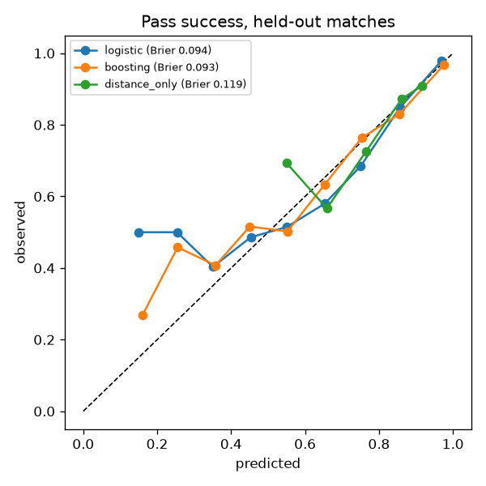 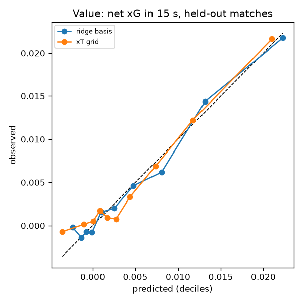 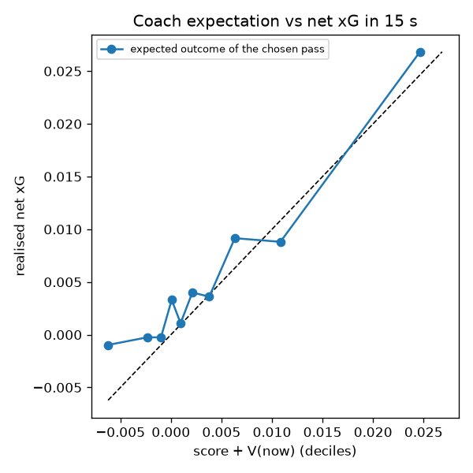

**What the numbers say.**

- **The pass model is real.** Even in the pessimistic leak check (AUC 0.77–0.81) it is far better than distance
  alone (0.50) and than pitch control alone (0.74). Calibration is good where most passes are (p > 0.5).
- **The value model is calibrated but weak.** It explains about 2 % of the variance of what happens in the next
  15 s, and it is no better than "distance to goal". Goals are rare; 7 matches are not enough to learn more than
  "closer is better". The 10 / 15 / 20 s horizons give the same picture (skill 2.9 / 2.2 / 1.7 %).
- **Our shot model loses to the provider's xG** (AUC 0.63 vs 0.82): 160 shots are far too few. The engine uses
  the provider's xG where it has it and our model only as a fallback.
- **The coach is calibrated in expected goals but not a better ranker than V alone.** For the pass the player
  actually made, the coach's expected outcome tracks the realised net xG (Spearman 0.24, 95 % CI 0.22–0.26, slope
  1.15): when it says a choice is worth more, it usually is. But ranking by V(target) alone does as well (0.24).
- **It plays bolder than the pros.** Completion of the pass the player chose, by the coach's rank of that option:
  rank 1: 69 %, ranks 2–3: 78 %, 4–6: 81 %, 7+: 85 %. Its top suggestions are the riskier, more valuable passes.
  It agrees with the receiver the pro chose in 37 % of cases (top-3), about the same as random (30 %); the
  nearest-teammate rule agrees 67 %. That is expected (a coach that copied pros would be pointless), but it also
  means the advice is a *value* opinion, not a prediction of what a player will do.

**Limits.** 7 matches from one league; event sync drops a third of the passes; failed-pass targets are inferred;
associations, not causal effects (players choose their passes). Logistic and ridge models were kept on purpose: the
browser runs the exact same formulas.

### Cross-league check: SkillCorner A-League (20 matches)

Tracking and event data: SkillCorner open data (MIT), 20 A-League 2024/25 matches. **Broadcast** tracking at 10 fps
(players off screen are extrapolated), events derived from it. [`coach/skillcorner.py`](coach/skillcorner.py)
streams each 89 MB tracking file and converts it in memory to the same match format (metres, centred, each pitch
rescaled to 105 × 68, owner, ball in play = inside a SkillCorner phase of play); only small derived tables are kept.
[`coach/cross_league.py`](coach/cross_league.py) scores every model on held-out matches with four training sets:
own league (plain leave-one-match-out), other league (the cross-league test), both leagues, both + a league flag.

**Data checks.** Event coordinates are attack-normalised (checked against the passer's tracked position: 0.1 m
after rotation, 60 m without). Events carry frame numbers on the tracking clock, so no offset has to be estimated:
at the event frame the passer is a median **1.1–1.4 m** from the ball (90th percentile 2.0–2.8 m) per match, and
91–97 % of passes and shots have their actor within 3 m (kept; 92–98 % of passes survive, vs 66 % for the
hand-logged Bundesliga events). While the ball is in play ~21.6 players are present per frame but only **54–73 %**
of positions are detected (12–16 players), the rest extrapolated; the ball is detected 90–95 % of the time. The
intended receiver of failed passes is given by SkillCorner (no inference needed). There is **no xG**: shots are
possessions ending in a shot (526, 61 of the 66 goals scored are attached to one; the rest fall in gaps such as
replays). Value labels there use an **xG proxy**: a logistic model fitted on the Bundesliga shots to reproduce the
provider's xG from our shot features. It is rough (correlation 0.44 with the provider's xG on held-out Bundesliga
matches, goal AUC 0.67 vs 0.81 for the provider; 0.75 on the A-League goals, 51.5 proxy xG for 61 goals).

| Pass model, logistic (log-loss / AUC) | own league | other league | both | both + flag |
|---|---|---|---|---|
| held-out Bundesliga (3,464 passes) | **0.378** / 0.838 | 0.399 / 0.839 | 0.391 / 0.841 | 0.387 / 0.840 |
| held-out A-League (14,844 passes) | **0.309** / 0.860 | 0.330 / 0.837 | 0.310 / 0.857 | 0.310 / 0.857 |

| Value model, ridge (MSE skill / Spearman) | own league | other league | both |
|---|---|---|---|
| held-out Bundesliga (provider xG labels) | **2.2 %** / 0.235 | 1.9 % / 0.239 | 2.1 % / 0.239 |
| held-out A-League (proxy xG labels) | **5.1 %** / 0.273 | 4.8 % / 0.274 | 5.1 % / 0.274 |

| Shot → goal, logistic (log-loss / AUC) | own league | other league | both |
|---|---|---|---|
| held-out Bundesliga (168 shots) | 0.319 / 0.617 | **0.298 / 0.686** | 0.301 / 0.667 |
| held-out A-League (526 shots) | 0.322 / 0.735 | 0.320 / 0.749 | 0.321 / 0.738 |

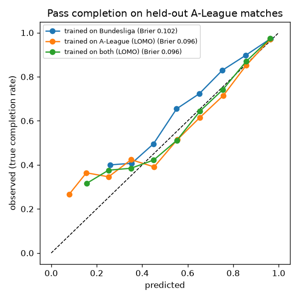 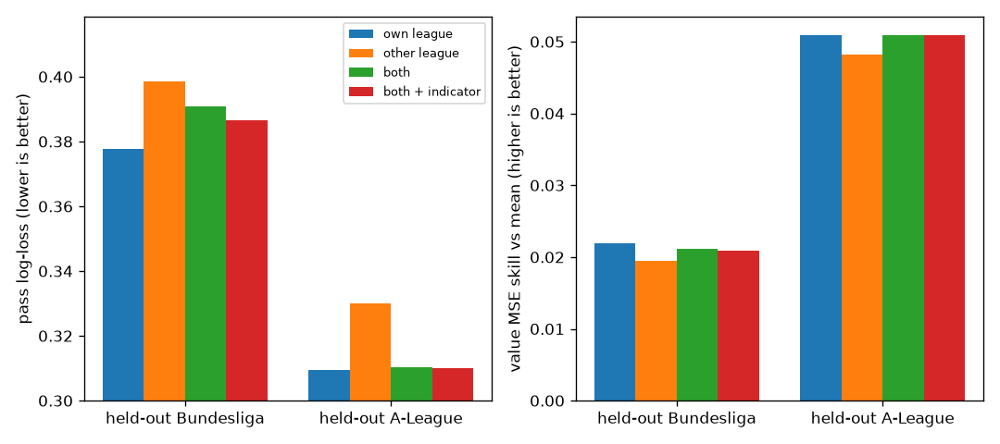

- **The pass model travels.** Trained on 7 Bundesliga matches it ranks A-League passes almost as well as an
  A-League model (AUC 0.837 vs 0.860), also when passer and target are both detected (0.824, 12,237 passes). What
  breaks is calibration: it predicts 81 % completion where 84.9 % happen (A-League passes complete more for the same
  geometry). The leak check transfers too (interceptor removed: AUC 0.77 cross-league, 0.80 in-league).
  SkillCorner's own xPass column scores higher (AUC 0.90) but is a reference, not a like-for-like rival: it is
  computed by the provider with its own inputs.
- **More matches do not help the browser models.** Pooling both leagues leaves the A-League pass model unchanged
  (0.310 vs 0.309) and makes the Bundesliga one worse (0.391; 0.387 with a league flag), because the two datasets
  define failed-pass targets differently (inferred vs given) and the coefficients differ. Only gradient boosting
  with a league flag gains on the Bundesliga (0.369 vs 0.381). The value model is the same "closer is better"
  with any training set (2.1–2.2 % skill on the Bundesliga).
- **The A-League value skill (5 %) is a label artefact**: the same Bundesliga matches scored with proxy-xG labels
  give 6.0 %. Proxy labels are a smooth function of position, so position predicts them better; they are not
  evidence of a better value model.
- **Shots are where more data helps.** The Bundesliga shot model goes from AUC 0.62 (168 shots) to 0.69 when trained
  on the 526 A-League shots (0.67 pooled). The engine still prefers the provider's xG where it exists.

**The website's shot model is trained on both leagues.** `coach.export` fits its shot logistic on the placed
non-penalty Bundesliga shots of the 6 matches other than the replay match plus the 526 open-play A-League shots (663
shots; `models.json` records them in `shot_trained_on`); the pass and value models stay Bundesliga-only. Held-out
evidence for this exact recipe ([`coach/shot_pooled.py`](coach/shot_pooled.py),
[`docs/coach_shot_pooled_results.json`](docs/coach_shot_pooled_results.json)): leave-one-match-out over the 7
Bundesliga matches (160 placed open-play shots, 16 goals), each fold adding all 526 A-League shots to the training
set, gives log-loss **0.306** vs 0.325 Bundesliga-only, Brier **0.0867** vs 0.0912 and AUC **0.677** vs 0.634 (paired
bootstrap over shots, 95 % interval of the difference: log-loss -0.032 to -0.006, Brier -0.008 to -0.001, AUC +0.010
to +0.074). The gain is real but rests on 16 goals, and the AUC varies a lot from match to match (0.12 to 1.00 with
1 to 4 goals each). It differs from the 0.62 → 0.69 in the table above, which trains on the A-League shots alone and
scores 168 shots (unplaced ones included). Limits: broadcast tracking (a third of positions extrapolated), no xG (proxy labels), goals missing
from 5 of 66, crosses approximated (wide channel to a target in the box), set-piece deliveries absent from the
events, 20 matches of one season.

### Player profiles: do per-player offsets help on unseen matches?

Design: [`docs/superpowers/specs/2026-11-02-player-profiles-design.md`](../docs/superpowers/specs/2026-11-02-player-profiles-design.md).
Before a match, the coach can load a `profiles.json`: for each player, an **offset on the logit scale** of an
existing model, with its sample size. Pass: `logit(p) += a · pass_skill(passer)`; shot: `logit(xG) += a ·
finishing(shooter)`. A missing player or field leaves the coach exactly as before.

- **Offsets** ([`coach/profiles.py`](coach/profiles.py)): completions minus the pass model's expectation (goals minus
  the provider's xG for finishing), shrunk towards 0 by empirical Bayes: `Σ w(y − p) / (Σ w p(1 − p) + k)`. A player
  with 5 passes stays at about 0. `k` is chosen by held-out log-loss with the offsets used as estimated (`a` = 1),
  then the scale `a` is fitted for that `k`. Both are chosen inside the training matches (each training match scored
  with offsets from the others). The expectations behind the offsets are themselves out-of-fold.
- **Providers**: `open_data` (this phase) builds offsets from our tracked matches, plus display-only descriptors from
  the SkillCorner season aggregates (dangerous passes / 30 min, completion vs SkillCorner xPass, off-ball runs / 30
  min, top speed; 248 of the 267 A-League passers are covered). An `api` interface (season goals / xG / passes from
  a live provider) is defined and tested with a fake. This phase makes no real API calls and handles no keys.
- **Test** ([`coach/profiles_eval.py`](coach/profiles_eval.py)): leave-one-match-out. For each held-out match, the
  model *and* the profiles come only from the other matches. The 95 % CI resamples whole matches (2,000 draws).

| Held-out (leave-one-match-out) | log-loss without → with | Brier without → with | log-loss difference, 95 % CI | held-out rows with a profile |
|---|---|---|---|---|
| Pass, Bundesliga (3,464 passes, 7 matches) | 0.3776 → 0.3779 | 0.1245 → 0.1247 | +0.0003 [−0.0006, +0.0011] | 35.8 % |
| Pass, A-League (14,844 passes, 20 matches) | 0.3094 → 0.3086 | 0.0960 → 0.0958 | **−0.0008 [−0.0015, −0.00003]** | 85.9 % |
| Shot, provider xG (160 shots) | 0.2537 → 0.2537 | 0.0716 → 0.0716 | 0 (`a` = 0 in every fold) | 35.6 % |
| Shot, coach logistic (160 shots) | 0.3246 → 0.3246 | 0.0912 → 0.0912 | 0 (`a` = 0 in every fold) | 35.6 % |

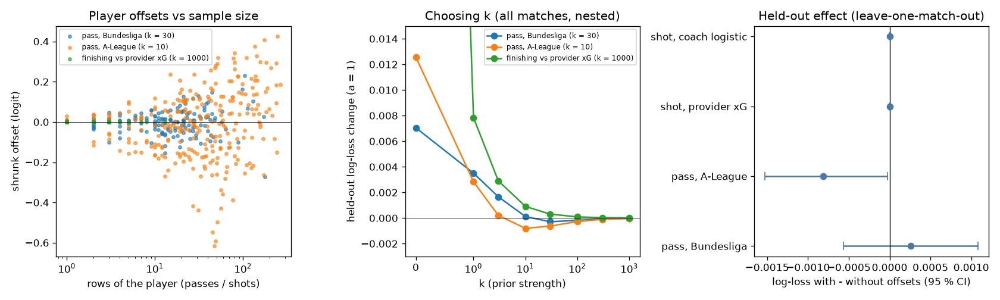

- **Bundesliga passes: no measurable gain.** Only 36 % of held-out passes have a profile: Düsseldorf plays in 5 of
  the 7 matches and every other team in one. The folds disagree on the settings (`k` from 10 to 1,000, `a` from 0.5
  to 2), which is what noise looks like. With all 7 matches, the best `k` is 30. The offsets then stay small: 5–95 %
  range −0.10 to +0.10 logit (about ±1.6 points at p = 0.8), largest 0.27, median 15 passes per player.
- **A-League passes: a small real gain.** Teams meet several times in 20 matches, so 86 % of held-out passes have a
  profile. Every fold picks `k` = 10, and `a` = 0.75 in 18 of the 20 folds. The gain is 0.0008 log-loss (0.3 %),
  with a CI just below 0. The Brier CI still overlaps 0 ([−0.0004, +0.0001]). Offsets with all 20 matches: 5–95 %
  range −0.26 to +0.28 logit, median 36 passes per player.
- **Finishing: nothing to learn from 160 shots.** The median shooter has 1 shot (75 shooters, 16 goals). The best
  `k` is the largest on the grid (1,000), and `a` = 0 in every fold. Raw "goals minus xG" per player is pure noise.

**Ship decision (rule from the spec): display-only.** The rule is applied to the models the website uses: the
Bundesliga pass model and the provider's xG. Offsets may change the advice only if the 95 % CI of the held-out
log-loss difference lies entirely below 0. Neither CI does, so the website shows the profiles as player cards
(offsets with sample sizes, no "good / bad" labels) and the advice is unchanged. The A-League result shows that
per-player pass offsets help once players have tens of passes in several training matches. They are worth enabling
when more Bundesliga matches per team are available.

`profiles.json` for the replay match J03WOH ([`coach/export_profiles.py`](coach/export_profiles.py), separate from
`coach/export.py`) is built from the 6 other matches only (`built_without: ["J03WOH"]`). It is 3 KB, with 13 players
(Düsseldorf, from the 4 other Düsseldorf matches). Regensburg plays in no other match, so its players have no profile.
The file carries `a = 0` for both models, the fitted values (`a_fitted`) and `advice_effect: "display-only"`. Players
are keyed by their index in `match.json`, with the DFL PersonId kept in `id` / `mapping`. Not tried yet: a receiver
term and team-level offsets. Season aggregates include every match of the season, so they are never used in the
held-out offsets. Numbers: [`docs/coach_profiles_results.json`](docs/coach_profiles_results.json).

### Match report: decision quality and missed opportunities

Design: section A of [`docs/superpowers/specs/2026-11-02-coach-insight-design.md`](../docs/superpowers/specs/2026-11-02-coach-insight-design.md).
[`coach/report.py`](coach/report.py) goes through every pass the sync placed on the tracking. The models are always
trained **without** that match (the code checks this). For each pass it keeps the coach's options at the release frame
(passes, carries, shot), the pass the player chose and the coach's best option. It records the **gap** =
score(best) − score(chosen) in expected goals (≥ 0), the rank of the chosen pass among all options, and what happened
within 15 s (goal or shot by the passing team, otherwise the pass completed or lost, plus net xG). The report then sums
this up per player, per team and per third of the pitch. It also lists 10 **biggest missed opportunities** (largest gap,
counted only when the best option succeeds with p ≥ 0.5, so the coach isn't asking for a miracle) and 10 **best
decisions** (the chosen pass was the coach's best option, ranked by how far it scores above the median option). The
per-pass work is shared with the held-out advice evaluation (`evaluate.pass_decisions`). The models use the website's
recipe (`export.fit_models`).

**Held-out, 7 Bundesliga matches** (each match scored with models trained on the other 6, shot model also on the
A-League shots; [`docs/coach_report_results.json`](docs/coach_report_results.json)):

| | All 7 matches | Per match |
|---|---|---|
| Decisions (synced open-play passes) | 3,464 of 5,241 (66 %) | 385–587 |
| Chosen pass = the coach's best option (top-1) | 8.8 % (random choice: 6.7 %) | 5.9–10.6 % |
| Chosen pass in the coach's top 3 | 30.6 % (random choice: 20.0 %) | 26.7–34.3 % |
| Gap to the best option: median / 90th pct / max | 0.0037 / 0.011 / 0.13 xG | median 0.0031–0.0043 |
| Best option is a pass / carry / shot | 83.5 / 7.2 / 9.3 % | |
| Missed-opportunity candidates (gap > 0, best p ≥ 0.5) | 2,296 | 248–413 |
| Best-decision candidates (chosen = best) | 304 | 25–59 |

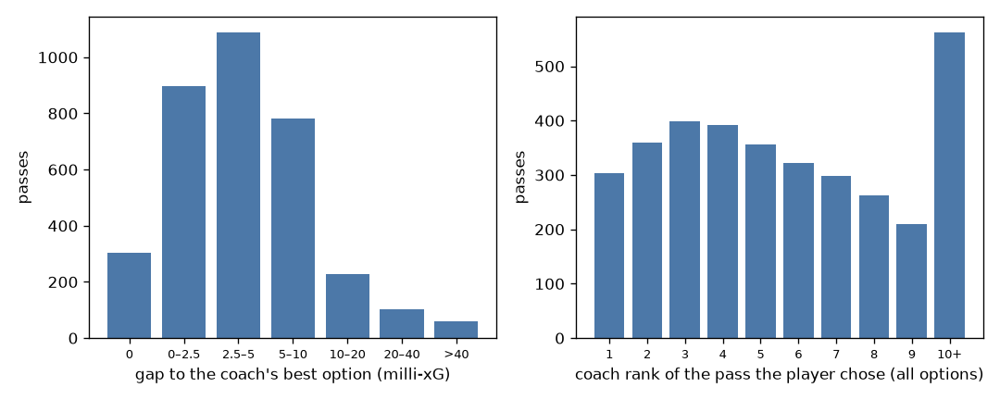

- **The gaps are small.** Half of the passes are within 0.004 xG of the coach's best option, and 90 % within 0.011.
  Large gaps (> 0.04 xG) are rare: 61 passes over the 7 matches. In J03WOH all 8 of them are passes
  in the attacking third where the coach would rather shoot (xG 0.06–0.12). The p ≥ 0.5 filter keeps them out of the
  missed-opportunity list, whose 10 entries there are passes with gaps of 0.010–0.017 xG.
- **Players rarely make the coach's first choice.** The share is only a little above a random pick among the ~15
  options (8.8 % vs 6.7 % top-1, 31 % vs 20 % top-3). The ranking counts carries and shots too, which a passer has by
  definition not chosen. This matches what we already knew: the coach is a value opinion, bolder than the pros, not a
  model of what players do.
- **Honesty, repeated in every report** (`caveats`): it is the model's opinion. A "missed opportunity" means the model
  valued another option more, not a mistake. The value model explains about 2 % of the variance of the next 15 s.
  Only synced passes are included (two thirds in this data), and failed-pass targets are inferred. Player and team
  numbers need **n ≥ 20** decisions; below that they are flagged `too_few` (22 of the 29 passers in J03WOH). There are
  no "good / bad player" labels.

**Website export.** [`coach/export_report.py`](coach/export_report.py) writes `report.json` for J03WOH into the site
export: **117 KB** (limit 300 KB), 385 decisions, 29 passers. Before writing, it checks that each decision's `frame`
equals the frame of the same event in the site's `match.json` (12.5 fps; `frame_src` keeps the 25 fps index, `event`
the index in the events list). It also checks that the pass model is identical to `models.json`. Schema: `summary`,
`teams` (+ `by_third`), `players` (keyed by `match.json` player index, with name, team, shirt, `n`, `too_few`, `top1`,
`top3`, `mean_gap`, `total_gap`), `highlights.missed` / `highlights.best` (indices into `decisions`), `decisions`
(half, frame, carrier, chosen target, best option kind / target / angle, gap, rank, p of the chosen and best options,
outcome, net xG), plus `fields`, `caveats`, `thresholds` and `trained_on`. The report also runs on a SkillCorner
match (10 fps, `frame` = `frame_src`). The 20 A-League matches are not summarised here: their tracking is not cached,
so it would mean streaming 1.7 GB again.

### Explanations and ghosts

Design: section B of [`docs/superpowers/specs/2026-11-02-coach-insight-design.md`](../docs/superpowers/specs/2026-11-02-coach-insight-design.md).
Both are the **model's suggestion, not ground truth**.

**Explanations** ([`coach/explain.py`](coach/explain.py)). The pass and shot models are logistic regressions, so each
feature's share of the logit is exact: `coef · (x − mean) / scale` (the shares plus the intercept give the logit back).
The score splits exactly too: score = p · gain + (1 − p) · loss, with gain = V(target) − V(now) and loss =
−V_opp(loss point) − V(now). Each option gets 2–3 phrases: the two features with the largest |share| (marked as
helping or hurting), then the value terms. A carry's p is pitch control, not a fitted model, so it gets its control and
the value terms. The wording lives in one table (`PHRASES`) with one rounding rule (`fmt`: half away from zero, the
same IEEE operations as `Math.floor(Math.abs(y) * 10 ** nd + 0.5)`), so the site's TypeScript port prints the same
text. Example (J03WOH, first half, 3:24, the coach's top option):
*long pass (49 m)* · *receiver has 3.8 m of space* · *+0.007 xG if it arrives, -0.002 if lost there*.

**Ghosts** ([`coach/ghosts.py`](coach/ghosts.py)). Pure functions of one frame. For each player: a fan of 7 points,
7.5 m away (5 m/s for 1.5 s), from −90° to +90° around his running direction (towards the opponent goal when he moves
slower than 1 m/s). The moved player stands still at the point. Nobody else reacts.
- *Ghost runs*: for each teammate of the carrier, the pass to each fan point is scored with the same formula
  (advice.py). If the best point beats the pass to his real position by more than 0.005 xG, a ghost is drawn there.
  At most 3, largest gain first. In the example above: three runs, worth +0.011, +0.009 and +0.006 xG.
- *Ghost defence*: greedy, one defender at a time, at most 3. Each step tries every remaining defender at every fan
  point and keeps the move that lowers the attacking team's best option (all options) the most, if by more than
  0.002 xG. In the example: one defender, −0.003 xG.

On the 30 parity frames: 1.6 ghost runs and 0.5 ghost defenders per frame.

**Cost per pause.** Ghost runs take 70 pass evaluations. Ghost defence needs at most 7 × (11 + 10 + 9) + 1 = 211 full
option rankings. Python (NumPy, one row at a time): 0.2 s for the runs and 1.7 s on average for the defence (max
3.6 s). That is fine for offline analysis, too slow to be a guide for the browser. Browser estimate: the site's own
TypeScript port, run in node (V8) on the same 30 frames with every defence step forced: one ranking 0.02–0.04 ms,
ghost runs 0.1–0.2 ms, ghost defence 3–6 ms on average and at most 4.3–7.6 ms. That is 6× or more under the spec's
50 ms on a laptop, so the 7-point fan stays.

**Association check** ([`coach/ghosts_eval.py`](coach/ghosts_eval.py), [`docs/coach_ghosts_results.json`](docs/coach_ghosts_results.json)).
Held-out passes of the 7 Bundesliga matches, models trained without the match. The ghosts are computed 1.5 s before
the release, for the 1,058 passes whose passer already had the ball then, which gives 2,070 ghost runs. A teammate
"followed" his ghost if he covered at least half of the ghost run by the release (projection of his real movement on
it): 335 did. Followed minus not followed, 95 % intervals from resampling whole matches:

| | Followed (n = 335) | Not followed (n = 1,735) | Difference [95 % CI] |
|---|---|---|---|
| Received the pass | 11.9 % | 4.5 % | **+7.4 pts** [+3.7, +12.0] |
| Score of the pass when he received it | −0.0021 xG (n = 40) | −0.0046 xG (n = 78) | **+0.0026** [+0.0018, +0.0037] |
| Score of the pass to him at the release | −0.0046 xG | −0.0034 xG | −0.0011 [−0.0018, −0.0006] |
| Change since the ghost was computed | +0.0002 xG | −0.0003 xG | +0.0005 [−0.0001, +0.0010] |
| Share of the predicted gain realised | 3 % | | |

**This is association only, not causation.** Players who make the run the model suggests get the ball more often,
and the passes they get score higher. But almost none of the gain the ghost promised is still there at the release
(3 %): in reality the defenders react, and in the ghost they don't. Treat ghosts as "the model sees space there now",
not "run there and the chance will still exist". Other limits: the moved player stands still at his point, and the
other options are not re-scored after a ghost run. The value model is weak (about 2 % of variance), so every gain is a
few thousandths of an xG.

**Parity.** [`coach/parity_fixtures.py`](coach/parity_fixtures.py) now also writes, for each frame, `v_now`,
`explanations` (shares, value terms, phrases, signs, aligned with `options`) and `ghosts` (`runs`, `defence`). At the
top it writes the phrase table (`explain`) and `ghost_params`. The earlier fields are unchanged (checked key by key).
Entries flagged `fragile` sit within 1e-6 of a rounding boundary (1 explanation of 453) or have a near-tie between
ghost candidates (4 of 64 ghosts, all defence: several moves leave the same option best). For those, the site compares
the numbers but not the text or the choice.

### Benchmark vs xT and VAEP

Design: section C of [`docs/superpowers/specs/2026-11-02-coach-insight-design.md`](../docs/superpowers/specs/2026-11-02-coach-insight-design.md).
Full technical report: **[`docs/coach_benchmark.md`](docs/coach_benchmark.md)**.

Two published methods were re-implemented on the same 7 matches. No code was copied. The first is **expected threat**
(Singh 2019, [`coach/xt.py`](coach/xt.py)): a 16 × 12 grid with value iteration over move and shot probabilities.
The second is **VAEP** (Decroos et al. 2019, [`coach/vaep.py`](coach/vaep.py)): a SPADL-like action table with
passes and shots from the events and carries from the tracking, the game state of the last 3 actions, and
P(score) / P(concede) within 10 actions. Each pass is valued by all three methods, leave-one-match-out, on the 3,464
passes of the match report ([`coach/benchmark.py`](coach/benchmark.py)). 95 % intervals resample whole matches.

| Held-out passes (n = 3,464) | Coach | xT | VAEP |
|---|---|---|---|
| Value after the pass vs net xG in the next 15 s (Spearman) | 0.24 [0.22, 0.26] | **0.25** [0.22, 0.28] | 0.18 [0.13, 0.23] |
| Same, completed passes | 0.26 [0.23, 0.30] | **0.28** [0.26, 0.31] | 0.20 [0.14, 0.25] |
| AUC: the passing team scores within 15 s (28 passes) | 0.74 [0.71, 0.80] | **0.77** [0.71, 0.85] | 0.66 [0.54, 0.79] |
| Agreement with the coach's V(target) − V(start), completed passes | – | 0.66 [0.64, 0.69] | 0.25 [0.16, 0.34] |
| Agreement with the coach's risk-aware score, all passes | – | 0.31 [0.29, 0.33] | −0.02 [−0.06, 0.03] |
| Size / runs in the browser | 69 numbers, 2 kB / **yes, shipped** | 192 numbers, 2 kB / easy, not shipped | 296 tree nodes / not shipped (needs the action history) |

- **xT and the coach are about as good, and VAEP is behind.** The paired difference coach − xT is −0.013
  [−0.041, +0.012] on all passes and −0.017 [−0.028, −0.006] on completed passes. Both beat VAEP by 0.05–0.09.
  As *changes* (value after minus value before), every method says little about the next 15 s (|Spearman| ≤ 0.09).
- **They disagree on risk and on time.** The coach scores the decision before the ball is played. xT and VAEP score
  what happened. Risky passes that came off (goalkeepers' long balls, passes into the box) get a low coach score and
  a high xT or VAEP value. The coach also undervalues passes from the edge of the box, because it would rather
  shoot from there; most of those passes were followed by positive net xG.
- **VAEP is data-starved here.** 19 goals and no defensive actions in the events. Its classifiers had to be chosen
  by inner cross-validation (the default booster did worse than a constant), and its "concede" model is a constant.
- Only the coach values the options **not** taken, on one frame, which is what "pause and ask the coach" needs.

**A-League (20 matches, held-out, proxy xG).** The tracking and events were streamed again and kept compact on the
USB key (`coach.skillcorner --store-raw`). Each method is trained on the other 19 A-League matches. A-League shots get
the xG proxy fitted on Bundesliga shots (`cross_league.xg_proxy`).

| Held-out A-League passes (n = 14,844) | Coach | xT | VAEP |
|---|---|---|---|
| Value after the pass vs net xG in the next 15 s (Spearman) | 0.25 [0.23, 0.28] | **0.27** [0.24, 0.29] | 0.23 [0.19, 0.26] |
| Same, completed passes | 0.27 [0.24, 0.29] | **0.29** [0.26, 0.31] | 0.25 [0.21, 0.28] |
| AUC: the passing team scores within 15 s (150 passes) | 0.74 [0.68, 0.80] | **0.75** [0.72, 0.80] | 0.71 [0.66, 0.75] |

The ranking is the same as in the Bundesliga: coach − xT −0.016 [−0.023, −0.010] on completed passes, xT − VAEP
+0.038 [+0.019, +0.061]. With all 27 matches pooled, VAEP catches up in the Bundesliga (0.18 → 0.25), so its last
place there was a lack of data.

**Cut-backs are the coach's blind spot.** 7 of the 10 biggest A-League disagreements are completed cut-backs from the
byline area to the centre: the coach's bottom 1 %, xT's and VAEP's top 1 %. 3 of the 7 led to a goal within 15 s.
Over all 54 completed A-League cut-backs, the coach's median percentile is 4 % (xT 99.6 %, VAEP 99.5 %). They are
followed by 0.130 net xG vs 0.007 for other completed passes (difference +0.124 [+0.086, +0.153]), and 26 % lead to
a goal within 15 s (1 % otherwise). The Bundesliga shows the same direction on 7 cut-backs (+0.104 [+0.033, +0.199]).
The coach charges the pass's low completion probability and its own preference for a narrow-angle shot. It does not
see that the ball arrives in front of goal.

### Run the coach

```bash
cd 20-football-analytics
python -m coach.prepare --raw D:/football-coach/idsse-raw    # 7 matches, ~15 min, restartable
python -m coach.evaluate                                     # all numbers + charts (~10 min on CPU)
python -m coach.export --match J03WOH --site <folder>        # one match (h0/h1.bin int16 cm 12.5 fps, z0/z1.bin ball height) + weights
python -m coach.parity_fixtures                              # Python <-> TypeScript parity frames for the website
python -m coach.skillcorner                                  # 20 A-League matches streamed (1.7 GB), ~5 min
python -m coach.cross_league                                 # cross-league + combined numbers and charts (~3 min)
python -m coach.shot_pooled                                  # held-out check of the pooled shot model (~10 s after cross_league)
python -m coach.profiles_eval                                # player profiles held-out test + chart (~1 min after cross_league)
python -m coach.export_profiles --match J03WOH --site <folder>   # profiles.json for the replay match, built without it
python -m coach.report                                       # match report held-out summary, 7 matches + chart (~12 min)
python -m coach.export_report --match J03WOH --site <folder>     # report.json for the replay match, built without it (~3 min)
python -m coach.ghosts_eval                                  # ghost association check (held-out) + timing (~15 min)
python -m coach.benchmark                                    # benchmark vs xT and VAEP, held-out (~20 min)
python -m coach.skillcorner --store-raw D:/cv-data/skillcorner-raw   # A-League raw files kept (1.8 GB streamed, 133 MB kept)
python -m coach.benchmark --set aleague                      # the same on the 20 A-League matches (~30 min)
python -m coach.benchmark --set pooled                       # all 27 matches pooled (~40 min); --cutbacks: cut-back check
```

All numbers: [`docs/coach_results.json`](docs/coach_results.json),
[`docs/coach_skillcorner_results.json`](docs/coach_skillcorner_results.json),
[`docs/coach_shot_pooled_results.json`](docs/coach_shot_pooled_results.json),
[`docs/coach_report_results.json`](docs/coach_report_results.json),
[`docs/coach_ghosts_results.json`](docs/coach_ghosts_results.json),
[`docs/coach_benchmark_results.json`](docs/coach_benchmark_results.json) (+ `_aleague`, `_pooled`, `_cutbacks`). Tests: `tests/test_20_coach.py` (47),
`tests/test_20_profiles.py` (15), `tests/test_20_report.py` (14), `tests/test_20_explain.py` (15),
`tests/test_20_benchmark.py` (20).

## How it works

1. **Detection** ([`train.py`](train.py)): YOLO11n from COCO weights, fine-tuned at **960 px** (instead of
   640) so the ball stays more than a couple of pixels wide.
2. **Jersey color** ([`analytics.py`](analytics.py)): for each player, the shirt area (upper-middle of the
   box) is converted to Lab color; **grass-green pixels are masked out** so the pitch doesn't dominate.
3. **Teams**: k-means with 2 clusters on those colors. Players far from both cluster centers (> 2.5× the
   median distance) are labeled "other": typically the referee and goalkeepers, who wear different colors.
4. **Possession**: the player whose feet (bottom-center of the box) are closest to the ball, if close
   enough, gives the possessing team.
5. **Pitch landmarks** ([`train_pitch.py`](train_pitch.py)): YOLO11n-**pose** fine-tuned to output one "pitch"
   object with 32 keypoints (60 epochs, ~1 h on CPU; mosaic augmentation off, since four stitched pitches break
   the geometry). Horizontal flips are allowed because the layout has a known left/right mirror map.
6. **Homography + map** ([`pitch.py`](pitch.py)): `cv2.findHomography` with RANSAC from the confident landmarks
   to their real coordinates (a 120 m × 70 m template), then players' feet and the ball are projected and drawn.

## Data

- **Football players & ball detection** (Roboflow, Hugging Face mirror `keremberke/football-object-detection`,
  CC BY 4.0): 859 / 243 / 130 train / valid / test broadcast frames, classes `football` and `player`.
- **Football pitch keypoints** (Kaggle `danielmachniak/football-pitch-keypoints-detection`, MIT; Bundesliga
  broadcast frames): 222 / 30 / 24 train / valid / test, 32 landmarks per frame. The landmark numbering was
  checked by drawing the labels on training frames and against the dataset's left/right flip map.
- **Metrica Sports sample data** (github.com/metrica-sports/sample-data, games 1–2, tracking + events): no formal
  licence; the repo asks users to use it responsibly and to acknowledge Metrica Sports in public work. Used for
  stage S4 validation, not redistributed.
- **StatsBomb open data** (github.com/statsbomb/open-data), under the StatsBomb Public Data User Agreement
  (research/analysis use, no redistribution, StatsBomb attribution on published analysis). Only the shots are kept.
- **IDSSE Bundesliga tracking + events** (Bassek et al. 2025, figshare 10.6084/m9.figshare.28196177, CC BY 4.0,
  data owner DFL): 7 matches, used for the v3 coach. Raw XML (2.6 GB) on the USB key, compact matches in
  `../../cv-data/football-coach/`; never committed.
- **SkillCorner open data** (github.com/SkillCorner/opendata, **MIT**; "Tracking and event data: SkillCorner open
  data (MIT)"): 20 A-League 2024/25 matches, broadcast tracking at 10 fps + dynamic events + phases of play, used for
  the coach's cross-league test. Tracking streamed and parsed in memory; only derived tables in
  `../../cv-data/skillcorner/`; never committed.
- **Location:** `../../cv-data/football/` (not committed).

## Run it

```bash
.venv\Scripts\activate            # shared environment, from the repo root
cd 20-football-analytics
python prepare.py                 # zips → YOLO layout
python train.py --epochs 15       # ~2.5 h on CPU; --resume continues an interrupted run
python evaluate.py                # detection mAP, team clustering, possession, figure
kaggle datasets download danielmachniak/football-pitch-keypoints-detection -p ../../cv-data/football/pitch2 --unzip
python train_pitch.py             # ~1 h on CPU
python evaluate_pitch.py          # landmark + pitch-position error, tactical map figure
```

## What I learned / what didn't work

- **Small objects decide the score.** Player AP50 0.98 vs ball 0.44. Higher resolution (1280 px), a
  ball-specific detector, or tracking the ball between frames (it moves smoothly) are the standard fixes.
- **Unsupervised team split works well on clear kits** (silhouette 0.80), but team "A" and "B" are
  assigned **per frame**: the same team can be A in one frame and B in the next. A real system fits the
  team colors once per match, or tracks players across frames.
- **A moving camera needs a learned ruler.** Project 08 calibrates a fixed camera once by hand; a broadcast
  camera pans and zooms, so the pitch landmarks have to be found in every frame. 222 labeled frames were enough
  for a 2.5 m median position error.
- **Errors grow away from the visible landmarks.** The homography is exact where landmarks are and
  extrapolates elsewhere; the 90th-percentile error (6.2 m) comes from points far from any detected landmark,
  e.g. the far touchline when the camera shows one penalty area. Even perfect labels leave 0.8 m (lens
  distortion, labeling precision, and real pitches being smaller than the 120 × 70 m template).
- **Single frames, not video.** Possession and team stats over time need tracking (project 08's ByteTrack)
  on match footage; this dataset is a set of independent frames.

## Next steps

- Smooth the homography over time on match video (it changes slowly), and report distances run per player.
- Track players and ball across frames (ByteTrack) for possession percentages and passes.
- Fix team colors per match (fit on the first frames) so team identities stay stable.

## Tech stack

Python · Ultralytics YOLO11 · OpenCV (Lab color, masking) · scikit-learn (k-means, silhouette, xG models) · NumPy · pandas · SciPy (Hungarian) · networkx · Matplotlib
