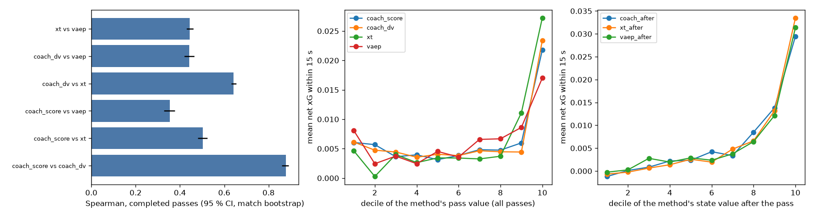

# Coach benchmark: our pass values vs expected threat (xT) and VAEP

Project 20, coach insight C (design: section C of
[`docs/superpowers/specs/2026-11-02-coach-insight-design.md`](../../docs/superpowers/specs/2026-11-02-coach-insight-design.md)).
Code: [`coach/xt.py`](../coach/xt.py), [`coach/vaep.py`](../coach/vaep.py), [`coach/benchmark.py`](../coach/benchmark.py).
Numbers: [`coach_benchmark_results.json`](coach_benchmark_results.json) (Bundesliga),
[`coach_benchmark_aleague_results.json`](coach_benchmark_aleague_results.json),
[`coach_benchmark_pooled_results.json`](coach_benchmark_pooled_results.json),
[`coach_benchmark_cutbacks.json`](coach_benchmark_cutbacks.json). Tests: `tests/test_20_benchmark.py` (20,
synthetic data).

**Question.** Our coach values each pass with three small models (pass completion, position value, shot) on one
tracking frame. Two well-known open methods value the same actions from event data alone. Do they agree, and which
one tracks what actually happened next?

**Short answer.** On 3,464 held-out Bundesliga passes, the coach's position value and xT rank completed passes in a
similar way (Spearman 0.66). VAEP agrees with neither (0.25 or less; with the coach's risk-aware score: −0.02). The
value *after* the pass predicts the next 15 s best for xT (Spearman 0.28 on completed passes) and the coach (0.26), then VAEP (0.20).
On completed passes xT is ahead of the coach by 0.017 [0.006, 0.028], and both are ahead of VAEP. Every method is
weak: the best explains little of what happens next. With 7 matches and 19 goals, VAEP is data-starved. Its
"concede" model never beat a constant. The coach is the only one that is shipped and runs in the browser on a live
frame. **On the 20 A-League matches** (14,844 passes, proxy xG) the ranking is the same: xT 0.27, coach 0.25, VAEP
0.23. With the 27 matches pooled, VAEP catches up in the Bundesliga. The clearest disagreement is **cut-backs**: the
coach puts them at a median percentile of 4 %, xT and VAEP at 99.5–99.6 %, and they are followed by +0.12 net xG
[+0.09, +0.15] more than other completed passes (see "The cut-back finding"; fixed afterwards, see "Cut-back fix": the figures above are the pre-fix coach).

## Data

7 full Bundesliga 2022/23 matches with tracking and official events (Bassek et al. 2025, DFL / Sportec Solutions,
CC BY 4.0). Every model is fitted **without the match it scores** (leave-one-match-out; asserted in the code).

**Action table** (`vaep.actions`, SPADL-like: type, result, start / end x-y with the acting team attacking +x, team,
player, time). The IDSSE events contain **passes and shots only**: no duels, tackles, interceptions, clearances or
dribbles. So the table holds:

| Action type | Count (7 matches) | How it is built |
|---|---|---|
| pass / cross | 5,241 / 140 | event start; a completed pass ends where the receiver stands when the ball reaches him (tracking, within 6 s); otherwise, and for a failed pass, at the start of the next action |
| set pieces (throw-in, free kick, corner, goal kick, kick-off) | 305 / 168 / 57 / 119 / 29 | as passes |
| carry | 1,756 | from the tracking: after a completed pass, the receiver's next action 3–60 m from where he received the ball, within 10 s (the way socceraction adds dribbles) |
| shot (open play / free kick / penalty) | 164 / 4 / 3 | ends at the goal centre; result = goal (19 goals) |

**Passes compared.** The 3,464 passes the match report scores (synced open-play passes, 66 % of 5,241), 2,934
of them completed. For each one, the four values below, the net xG of the passing team in the next 15 s (provider
xG of all shots, for minus against) and whether it scored within 15 s (28 passes) or within the next 10 actions
(VAEP's own label).

## Methods

| Value of a pass | Built from | Knows the result? |
|---|---|---|
| **coach_score**: p · V(target) − (1 − p) · V_opp(loss point) − V(now) | coach: pass model, value model, one tracking frame | no (ex ante) |
| **coach_dv**: V(target) − V(start) | coach value model (ridge on goal geometry) | no |
| **xt**: xT(end) − xT(start) if completed, −xT(start) if lost | xT grid | yes (ex post) |
| **vaep**: ΔP(score) − ΔP(concede) | VAEP classifiers on the last 3 actions | yes |

These are *changes*. The outcome (net xG in the next 15 s) is a *level*: it is high after any pass played near the
goal. So the calibration also scores like-for-like **values after the pass**: `coach_after` = coach_score + V(now)
(the coach's expected net xG after the decision), `xt_after` = xT where the ball ended (0 if lost), `vaep_after` =
P(score) − P(concede) after the pass.

**xT** (Singh 2019), [`coach/xt.py`](../coach/xt.py). 16 × 12 grid. Per cell: shot and move probabilities, the
scoring probability of a shot, and the move transition matrix (completed moves; failed moves count in the
denominator). Value iteration from 0 until the largest change is < 1e-6 (40–44 iterations per fold). Moves are
passes of every kind and carries; penalties are out. **Deviation:** Singh fitted a season. Here 6 matches give ~140
non-penalty shots, so the goal ratio is 0 or 1 in most cells. The scoring probability is the mean provider xG of the
cell's shots, shrunk towards the overall mean with 2 pseudo-shots (`goal_source="goals"` gives Singh's version).
Fitted on the 6 other matches for each held-out match. The grid rises from 0.006 in the own half to 0.31 in the
central cell at the goal (grid fitted on all 7 matches).

**VAEP** (Decroos et al. 2019), [`coach/vaep.py`](../coach/vaep.py). Game state = the action and the two before it
(type one-hot, result, start / end, movement, distance and angle to goal, all seen from the acting team, so an
opponent's action is rotated 180°), plus same-team flags, time gaps, the gap between consecutive actions, the score
and the time. 80 features. Labels: the acting team scores / concedes within the next 10 actions of the half. Value =
(P_score(aᵢ) − P_score(aᵢ₋₁)) − (P_concede(aᵢ) − P_concede(aᵢ₋₁)). The previous pair is swapped when aᵢ₋₁ was by
the other team, and is 0 at the start of a half or after a goal.

The coach's default booster (300 trees, depth 3) **overfit**: held-out log-loss 0.110 vs 0.094 for a constant on
"scores", and 0.048 vs 0.030 on "concedes". So each classifier is now chosen per held-out match, by an inner
leave-one-match-out over the 6 training matches only. The candidates are boosters with 300 / 50 / 30 trees (leaves
of ≥ 20 / 200 / 400 actions) and the base rate. Chosen: "scores" = 30 trees in 5 folds, 50 trees in 1, base rate
in 1. "Concedes" = **base rate in all 7** (38 positive labels: nothing to learn). Held-out "scores": log-loss 0.0931
vs 0.0943 for a constant, AUC 0.59. So VAEP here is in effect an offensive model plus the swap term.

## Results (held-out, 95 % intervals from resampling whole matches, 1,000 resamples)

**Agreement between methods** (Spearman on the same passes):

| Pair | All passes (n = 3,464) | Completed passes |
|---|---|---|
| coach_score vs coach_dv | 0.58 [0.55, 0.61] | 0.67 [0.64, 0.69] |
| coach_dv vs xT | 0.31 [0.27, 0.36] | **0.66** [0.64, 0.69] |
| coach_score vs xT | 0.31 [0.29, 0.33] | 0.37 [0.35, 0.39] |
| coach_dv vs VAEP | 0.23 [0.17, 0.29] | 0.25 [0.16, 0.34] |
| xT vs VAEP | 0.16 [0.08, 0.24] | 0.25 [0.17, 0.31] |
| coach_score vs VAEP | −0.02 [−0.06, 0.03] | −0.02 [−0.07, 0.04] |

The coach's value model and xT are both "how good is this place" maps, and on completed passes they mostly agree.
On all passes they agree less, because xT charges a lost pass −xT(start) and the coach's V(target) − V(start) does
not see the loss. The coach's score adds the risk (completion probability) and the shot option. It shares only a
third of its ranking with xT, and nothing with VAEP.

**Calibration against what happened** (Spearman with the net xG in the next 15 s; AUC for "the passing team
scores within 15 s", 28 passes):

| Value | Spearman, all | Spearman, completed | AUC goal ≤ 15 s, all |
|---|---|---|---|
| coach_score | −0.07 [−0.10, −0.05] | −0.08 [−0.12, −0.05] | 0.44 [0.27, 0.55] |
| coach_dv | 0.02 [−0.00, 0.05] | 0.05 [0.02, 0.07] | 0.56 [0.50, 0.60] |
| xT | 0.09 [0.07, 0.11] | 0.08 [0.06, 0.10] | 0.62 [0.48, 0.67] |
| VAEP | 0.06 [0.02, 0.09] | 0.07 [0.03, 0.12] | 0.57 [0.49, 0.72] |
| **coach_after** (score + V(now)) | 0.24 [0.22, 0.26] | 0.26 [0.23, 0.30] | 0.74 [0.71, 0.80] |
| **xt_after** (xT where the ball ended) | **0.25** [0.22, 0.28] | **0.28** [0.26, 0.31] | **0.77** [0.71, 0.85] |
| **vaep_after** (P_score − P_concede) | 0.18 [0.13, 0.23] | 0.20 [0.14, 0.25] | 0.66 [0.54, 0.79] |

Paired differences (same passes, same resamples):

| Difference in Spearman with net xG | All passes | Completed passes |
|---|---|---|
| coach_after − xt_after | −0.013 [−0.041, +0.012] | −0.017 [−0.028, −0.006] |
| coach_after − vaep_after | +0.055 [+0.009, +0.111] | +0.068 [+0.024, +0.122] |
| xt_after − vaep_after | +0.068 [+0.027, +0.115] | +0.086 [+0.044, +0.140] |
| coach_dv − xt | −0.069 [−0.107, −0.038] | −0.036 [−0.073, −0.009] |

- **As changes, all four values say little about the next 15 s** (|Spearman| ≤ 0.09). The coach's score is even
  slightly negative. It subtracts V(now), so passes played from dangerous places score low, and those are exactly
  the passes followed by shots. Consistency check: both coach numbers (−0.069 as a change, 0.237 as a level) are
  identical to the earlier held-out advice evaluation (`docs/coach_results.json`).
- **As levels, xT and the coach are close, and both beat VAEP.** On all passes xT and the coach cannot be told apart
  (−0.013 [−0.041, +0.012]). On completed passes xT is slightly ahead (0.017 [0.006, 0.028]). Both beat VAEP by
  0.05–0.09. For all three, the top decile of the after-value is followed by 0.025–0.028 net xG, the bottom half by
  ≤ 0.004. The coach's after-value is in net-xG units, and its slope of 1.15 [0.79, 1.67] says its scale is roughly
  right.
- **VAEP is hurt most by the data size.** It is built to learn from seasons of events (the paper used thousands of
  matches). Here it has 19 goals, no defensive actions, and a constant "concede" model.

**The 10 passes where the methods disagree most** (percentile ranks of coach_score, xT and VAEP over the 3,464
passes; positions in metres, the passing team attacks +x, goal at x = 52.5; `pct` = percentile of the value):

| Match, min | Pass (players) | From → to | Done | p | coach_score | xT | VAEP | pct coach / xT / VAEP | Net xG 15 s |
|---|---|---|---|---|---|---|---|---|---|
| J03WOH 43' | Kastenmeier → de Wijs | (−17, 24) → (30, −27) | no | 0.57 | +0.0087 | −0.007 | −0.082 | 1.00 / 0.16 / 0.00 | 0 |
| J03WR9 7' | Hennings → Oberdorf | (46, 7) → (49, −5) | yes | 0.35 | −0.0170 | −0.088 | +0.094 | 0.00 / 0.00 / 1.00 | +0.235 |
| J03WOH 2' | Albers → Breitkreuz | (50, 11) → (47, 3) | yes | 0.41 | −0.0144 | +0.170 | +0.018 | 0.01 / 1.00 / 0.86 | +0.090 |
| J03WR9 91' | Karbownik → Kownacki | (36, 15) → (49, −16) | yes | 0.33 | −0.0140 | −0.015 | +0.097 | 0.01 / 0.06 / 1.00 | 0 |
| J03WQQ 57' | Kastenmeier → Peterson | (−41, 2) → (25, −32) | yes | 0.50 | −0.0136 | +0.014 | +0.082 | 0.01 / 0.96 / 1.00 | 0 |
| J03WPY 69' | Fernandes Neto → Oberdorf | (34, 0) → (40, 6) | yes | 0.42 | −0.0147 | +0.025 | +0.065 | 0.00 / 0.99 / 0.99 | +0.101 |
| J03WPY 77' | Kastenmeier → Karbownik | (−43, 3) → (22, −14) | no | 0.61 | −0.0109 | −0.005 | +0.092 | 0.01 / 0.19 / 1.00 | +0.039 |
| J03WOH 80' | Makridis → Faber | (51, 16) → (28, −11) | yes | 0.95 | −0.0140 | +0.028 | +0.019 | 0.01 / 0.99 / 0.87 | +0.017 |
| J03WN1 75' | Riemann → Antwi-Adjei | (−36, 1) → (31, 20) | yes | 0.25 | −0.0168 | +0.020 | +0.036 | 0.00 / 0.98 / 0.96 | 0 |
| J03WPY 49' | Castrop → Daferner | (45, −19) → (45, −9) | yes | 0.40 | −0.0097 | +0.089 | +0.032 | 0.02 / 1.00 / 0.95 | +0.074 |

Patterns:
- **Ex ante vs ex post (5 of 10).** The coach scores the decision before the ball is played. xT and VAEP score
  what happened. Risky passes that came off get a low coach score (p 0.25–0.5) and a high xT or VAEP value. Examples
  are goalkeepers' long balls (Kastenmeier, Riemann) and passes into the box. The reverse happens too: Kastenmeier's
  long diagonal at 43' was the coach's favourite kind of pass (top 0.2 %), but it was lost, and VAEP ranks it
  last.
- **Passes from inside or at the edge of the box (4 of 10).** Albers, Makridis, Castrop, Fernandes Neto. The coach
  rates these below "now" because its value of the current spot is already high and it prefers a shot. xT rewards
  moving the ball into the central cells in front of goal. All 4 were followed by positive net xG (0.02–0.10).
  Here the coach's "shoot instead" opinion looks too strong.
- **Sparse xT cells.** Hennings' completed pass to the edge of the six-yard box gets xT −0.088, because that cell
  had few shots in the 6 training matches. VAEP ranks it at the top, and 0.235 net xG followed. With one season,
  Singh's grid would be smoother.
- With the overfit default booster (first run, not kept), VAEP gave values up to +0.81 to a goalkeeper's lost long
  ball after an opponent's chance (the swap term credits ending a chance the booster had overrated). These extremes
  disappeared once the classifiers were chosen by inner cross-validation.

## A-League (20 matches) and pooled 27 matches

**Data.** The 20 SkillCorner A-League 2024/25 matches (broadcast tracking at 10 fps, MIT). The tracking and events
were streamed again (1.79 GB) and kept in compact form on the USB key (133 MB,
`python -m coach.skillcorner --store-raw D:/cv-data/skillcorner-raw`). The store is restartable and never leaves a
truncated file. **SkillCorner has no xG.** Every A-League shot gets the proxy of `cross_league.xg_proxy`: a logistic
model fitted on the IDSSE shots only, so no A-League label leaks into it. Its quality: Pearson 0.44 with the provider
xG on held-out IDSSE shots, AUC 0.75 for A-League goals, 51.5 proxy xG for 61 goals. Every net-xG outcome, the
coach's value labels and xT's scoring probabilities on the A-League use this proxy. **No set pieces** in the action
table: SkillCorner records player possessions only. That leaves 15,679 passes, 324 crosses, 4,739 carries and 526
shots. The coach is trained on the other 19 A-League matches only (pass, value and shot models), and so are xT and
VAEP. VAEP's classifiers are chosen by 5-fold cross-validation over the 19 training matches. **"Scores"** used the
50-tree booster in all 20 folds: held-out log-loss 0.094 vs 0.108 for a constant, AUC 0.70. **"Concedes"** used a
booster in 15 folds and the base rate in 5. It is still no better than a constant (0.0370 vs 0.0361).

**Held-out A-League passes** (14,844, 12,722 completed; 150 followed by a goal within 15 s; 95 % intervals from
resampling whole matches):

| | Coach | xT | VAEP |
|---|---|---|---|
| Value after the pass vs net xG in 15 s, all passes (Spearman) | 0.25 [0.23, 0.28] | **0.27** [0.24, 0.29] | 0.23 [0.19, 0.26] |
| Same, completed passes | 0.27 [0.24, 0.29] | **0.29** [0.26, 0.31] | 0.25 [0.21, 0.28] |
| AUC: passing team scores within 15 s, all passes | 0.74 [0.68, 0.80] | **0.75** [0.72, 0.80] | 0.71 [0.66, 0.75] |
| Pass value as a change vs net xG in 15 s (coach: risk-aware score) | −0.02 [−0.04, −0.01] | **0.14** [0.13, 0.17] | 0.07 [0.05, 0.09] |
| Agreement with the coach's V(target) − V(start), completed passes | – | 0.77 [0.76, 0.78] | 0.43 [0.41, 0.45] |
| Agreement with the coach's risk-aware score, completed passes | – | 0.62 [0.60, 0.64] | 0.32 [0.29, 0.34] |

Paired differences in Spearman with the net xG (after-values): coach − xT −0.016 [−0.033, 0.000] on all passes and
−0.016 [−0.023, −0.010] on completed passes. Coach − VAEP +0.022 [−0.001, +0.047]. xT − VAEP +0.038 [+0.019,
+0.061]. **The Bundesliga ranking holds:** xT is slightly ahead of the coach, and both are ahead of VAEP. The gaps
are smaller here, because VAEP has 61 goals to learn from instead of 19. The methods agree more than in the
Bundesliga (coach_score vs VAEP 0.32 instead of −0.02).

**Pooled 27 matches** ([`coach_benchmark_pooled_results.json`](coach_benchmark_pooled_results.json)). Each match
is scored with all three methods fitted on the 26 others, Bundesliga and A-League together. Results stay per league.
On the **Bundesliga**, pooling mainly helps VAEP. Its after-value rises from 0.18 to 0.25 [0.22, 0.28], level with
the coach (0.24 [0.22, 0.26]; coach − VAEP −0.006 [−0.031, +0.015]) and xT (0.25 [0.22, 0.29]). Its goal AUC rises
from 0.66 to 0.78 [0.71, 0.88]. On the **A-League**, pooling changes nothing that matters (coach 0.26, xT 0.27,
VAEP 0.24). So VAEP's last place in the Bundesliga was a data-size effect, while xT's small lead over the coach is
seen in every setting.

### The cut-back finding

The biggest disagreements on the A-League share one shape: **7 of the top 10 are completed cut-backs**, passes from
the byline area back to the centre in front of goal. The coach puts each of them in its **bottom 1 %**. xT and VAEP
put them in their **top 1 %** (VAEP: top 6 % for one). They were followed by up to 0.56 net xG, and 3 of them by a
goal within 15 s.

| Match, min | Pass | From → to (m) | p | coach_score | xT | VAEP | pct coach / xT / VAEP | Net xG 15 s |
|---|---|---|---|---|---|---|---|---|
| 1927964 58' | T. Payne → H. Ishige | (49, -17) → (50, 2) | 0.20 | -0.0182 | +0.217 | +0.332 | 0.00 / 1.00 / 1.00 | +0.561 (goal) |
| 1959846 94' | R. Danzaki → H. Ibusuki | (42, -14) → (46, 1) | 0.18 | -0.0167 | +0.089 | +0.386 | 0.00 / 1.00 / 1.00 | +0.263 (goal) |
| 2011166 9' | S. Sutton → C. Piper | (48, 14) → (48, 3) | 0.45 | -0.0167 | +0.216 | +0.304 | 0.00 / 1.00 / 1.00 | +0.517 (goal) |
| 1874553 94' | P. Madanha → B. Folami | (51, -12) → (40, -11) | 0.81 | -0.0119 | +0.062 | -0.146 | 0.01 / 1.00 / 0.00 | +0.045 |
| 1986691 40' | M. Antonsson → Nicolas Milanovic | (44, 4) → (38, 2) | 0.89 | -0.0017 | -0.093 | +0.140 | 0.34 / 0.00 / 0.99 | +0.075 |
| 1925299 78' | A. Burke-Gilroy → T. Waddingham | (38, 16) → (46, -2) | 0.10 | -0.0133 | +0.217 | +0.177 | 0.01 / 1.00 / 1.00 | +0.311 |
| 1886347 27' | F. Gallegos → N. Pijnaker | (50, 20) → (47, 5) | 0.39 | -0.0129 | +0.242 | +0.197 | 0.01 / 1.00 / 1.00 | +0.182 |
| 1927964 92' | Juan Mata → A. Hammond | (34, -5) → (44, 1) | 0.24 | -0.0129 | +0.086 | +0.382 | 0.01 / 1.00 / 1.00 | +0.063 (goal) |
| 2011166 45' | D. Arzani → N. Velupillay | (48, -15) → (46, 6) | 0.39 | -0.0159 | +0.061 | +0.033 | 0.00 / 1.00 / 0.94 | +0.000 |
| 1874553 84' | H. Van Der Saag → F. Bérenguer | (46, -16) → (46, 5) | 0.43 | -0.0123 | +0.245 | +0.140 | 0.01 / 1.00 / 0.99 | +0.180 |
Over **all** completed passes ([`coach_benchmark_cutbacks.json`](coach_benchmark_cutbacks.json), `python -m
coach.benchmark --cutbacks`). A cut-back here is a completed pass from x ≥ 36 m and 12–25 m from the centre line to
|y| < 8 m, still at x ≥ 36 m.

| | Cut-backs | Coach median percentile | xT | VAEP | Net xG in 15 s: cut-backs vs other completed passes | Goal within 15 s |
|---|---|---|---|---|---|---|
| A-League | 54 | **4 %** | **99.6 %** | **99.5 %** | 0.130 vs 0.007, difference **+0.124 [+0.086, +0.153]** | 26 % vs 1.0 % |
| Bundesliga | 7 | 6 % | 99.6 % | 85 % | 0.110 vs 0.006, difference +0.104 [+0.033, +0.199] | 0 % vs 0.9 % |

**This is the coach's clearest blind spot.** Cut-backs are among the most dangerous passes in football. The coach
ranks them among the worst for two reasons. Its completion probability is low (median p = 0.67 on the A-League,
lower for the ones in the table), because the passer is under pressure near the byline. And its value of the
current spot is already high, while it prefers a shot from a narrow angle. xT and VAEP see that the ball arrived in
front of goal, and the data agrees with them. Two fixes to try: a value model that sees the receiver's shooting
chance rather than only the position, and a shot model with less weight on wide positions. Until then, the site's
"missed opportunity" and "best decision" lists will be wrong about cut-backs. Of the other 3 disagreements, one is
a through ball into the box: also in the coach's bottom 1 %, and followed by a goal. The other two are backward
passes out of the box, where the methods split.

### Cut-back fix: an arrival value for passes

[`coach/cutback.py`](../coach/cutback.py), numbers in [`docs/coach_cutback_results.json`](coach_cutback_results.json),
tests `tests/test_20_cutback.py`. Leave-one-match-out within each league. The benchmark JSONs and charts in this folder now hold the post-fix coach (the pre-fix cut-back numbers are `cutbacks_before` in the cutback JSON).

**Diagnosis.** The pass model is not the cause: on cut-back-shaped passes (completed or not) it predicts 0.58 and 0.63
complete on the A-League (n = 84), 0.49 vs 0.39 on the Bundesliga (n = 15). Cut-backs really fail one time in three.
The shot option is not the cause either: from goal angles under 0.25 rad the model gives 0.050 against 4 goals in 115
shots, and the provider/proxy xG agrees. The value of the target is. The possession value V is calibrated by zone
(central box: predicted 0.028, observed 0.030), but it is trained on every second of possession, and most box seconds
are circulation. A ball that *arrives* in the central box is worth 4-5 times more: 0.136 net xG after completed passes
into it (A-League, n = 64) against V = 0.027. For the median completed cut-back V(target) = 0.030 = V(now) 0.029, so
p * V(target) - V(now) is negative for any p < 1: bottom 4 %.

**Fix (one new model, same form).** A second ridge on the same 10-feature value basis, trained on *completed passes*:
x = the target's position at the release, y = net xG within 15 s of the release. It replaces V(target) for **pass
options only**; V(now), the loss point, carries and shots keep V.

| Held-out | Before | After |
|---|---|---|
| Median coach percentile of completed cut-backs, A-League (54) | 3.6 % | **99.1 %** |
| same, Bundesliga (7) | 5.9 % | **98.0 %** |
| Error of V(target) on completed passes (MSE), A-League | 1.397e-3 | 1.336e-3, gain +6.2e-5 [+1.6e-5, +1.1e-4] |
| same, Bundesliga | 1.613e-3 | 1.632e-3, gain -2.0e-5 [-1.0e-4, +4.0e-5] (not distinguishable) |
| Mean V(target) vs observed (A-League, Bundesliga) | 0.0039, 0.0045 vs 0.0075, 0.0061 | 0.0075, 0.0063 |
| Pass model, possession value V | | unchanged (same fits) |
| Coach score vs net xG in 15 s (Spearman), A-League / Bundesliga | -0.021 / -0.069 | **+0.086 [0.065, 0.103] / +0.083 [0.051, 0.110]** |
| Value after the pass (coach_after) vs net xG, A-League / Bundesliga | 0.254 / 0.237 | 0.250 / 0.239 |
| Coach score vs xT, all passes, A-League / Bundesliga | 0.455 / 0.306 | 0.350 / 0.228 |
| Coach score vs VAEP, all passes, A-League / Bundesliga | 0.294 / -0.016 | 0.269 / 0.010 |
| Coach after minus xT after (vs net xG), completed, A-League | -0.016 | -0.021 [-0.027, -0.015] |

Agreement with xT falls because the coach no longer ranks arrivals like xT does but now ranks the risk-adjusted score
in line with what followed; the like-for-like "value after the pass" comparison is unchanged. Side effect on the
held-out report (7 matches): the pro's pass is the coach's top choice 9.2 % vs 8.8 % of the time (top 3: 30.1 % vs 30.6 %),
but the coach recommends a pass as its best option more often (92 % vs 84 %; carries 2 % vs 7 %), and the gap between
the coach's best option and the pro's pass grows (mean 0.0074 vs 0.0059).

**Tried, not shipped.** Pass features target goal angle + central-box + box indicators: log-loss gain -0.0005 [-0.0027,
+0.0012] (Bundesliga), +0.0005 [-0.0003, +0.0012] (A-League). Central-box terms in the possession value: no gain
(|MSE gain| < 2e-6). A log-angle shot feature: log-loss gain -0.0003 [-0.0017, +0.0011]. **Limits:** 7 Bundesliga
cut-backs; the A-League benchmark was re-scored from its cached rows (the raw store was offline), which is exact up to
the rounding of the cached p (max difference 1.5e-4, checked against a full re-run on the Bundesliga); the pooled
27-match benchmark was not refreshed (it is the pre-fix coach). The earlier tables in this document are the pre-fix coach.

## Cost

| | Coach | xT | VAEP |
|---|---|---|---|
| What it needs | one tracking frame (22 players + ball, velocities) | start / end location and the result | the last 3 actions (type, result, start / end), times, score: an event stream |
| Model size | 69 numbers, 2.0 kB JSON (3 linear models) | 192 numbers, 1.9 kB JSON | 296 tree nodes ("scores") + a constant ("concedes"); 100 kB pickled (mostly sklearn binning tables) |
| CPU time (Python, this laptop) | 9.9 ms per pass, all ~15 options with pitch control | < 0.001 ms per action (table lookup) | 0.002 ms per action (vectorised) |
| In the browser | **yes, shipped** (the replay's coach, and the live mode to come) | trivially portable, not shipped | not shipped: needs the action history and a tree runtime or a JSON export of the trees |

Only the coach values options the player did *not* take. It scores every pass, carry and shot available on the
frame, which is what "pause and ask the coach" needs. xT and VAEP value only the action that was played, and only
after the fact. That is fine for rating players, but they cannot give advice on a frozen frame.

## Limits

- 7 matches, 3,464 passes, 28 passes followed by a goal within 15 s. The goal AUCs have wide intervals.
- The A-League has no provider xG. Its outcomes and labels use a proxy fitted on Bundesliga shots (Pearson 0.44 with
  the provider's xG), so A-League net xG is noisier than Bundesliga net xG. The A-League action table has no set
  pieces.
- Our xT uses shrunk provider xG per cell instead of the goal ratio. Failed moves get −xT(start), a convention: Singh
  values only successful moves.
- Our VAEP has no defensive actions (none in the events), a constant "concede" model, and 19 goals to learn from.
  It is a fair re-implementation of the method on this data, not a reproduction of the paper's numbers.
- The coach's value model explains ~2 % of the variance of the next 15 s (v3 README). All "calibration" here is
  weak in absolute terms.
- Pass ends come from the tracking (reception point) or the next event. Carries are inferred and succeed by
  construction.

## References

- Singh, K. (2019). *Introducing Expected Threat (xT)*. Blog post, karun.in/blog/expected-threat.html.
- Decroos, T., Bransen, L., Van Haaren, J., Davis, J. (2019). *Actions Speak Louder than Goals: Valuing Player
  Actions in Soccer*. KDD 2019. [doi:10.1145/3292500.3330758](https://doi.org/10.1145/3292500.3330758).
- Fernández, J., Bornn, L., Cervone, D. (2019). *Decomposing the Immeasurable Sport: A deep learning expected
  possession value framework for soccer*. MIT Sloan Sports Analytics Conference 2019. Background: a tracking-based
  value like the coach's.
- Bassek, M. et al. (2025). An integrated dataset of spatiotemporal and event data in elite soccer. *Scientific
  Data*. [doi:10.1038/s41597-025-04505-y](https://doi.org/10.1038/s41597-025-04505-y). CC BY 4.0.
- Both methods were re-implemented from the papers. No code was copied. The `socceraction` package (MIT) was not
  used. Its SPADL format and its way of adding carries inspired the action table.
