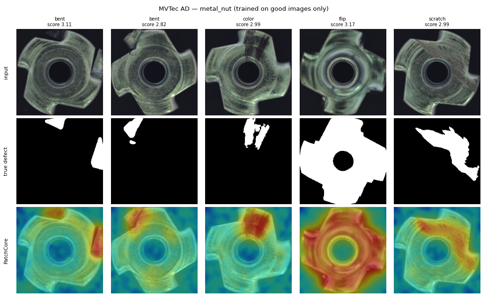
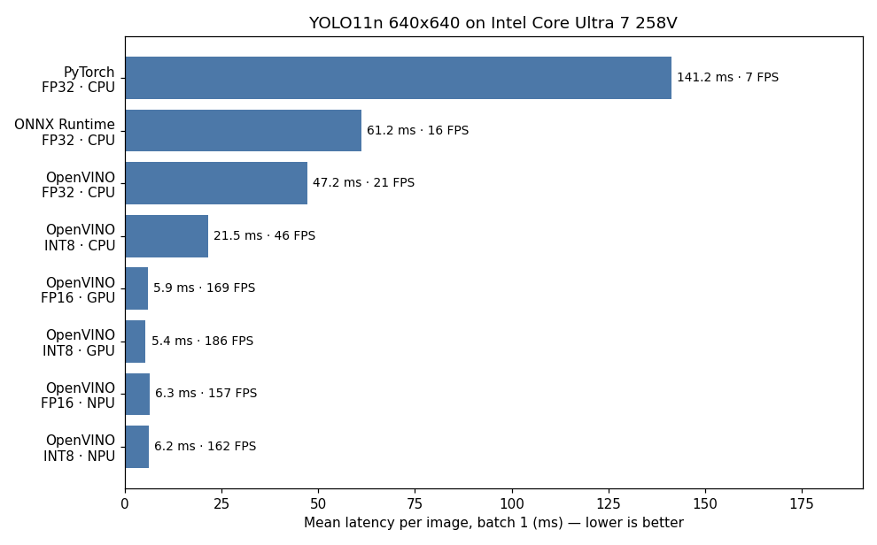
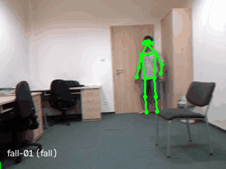
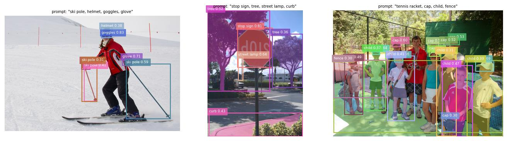
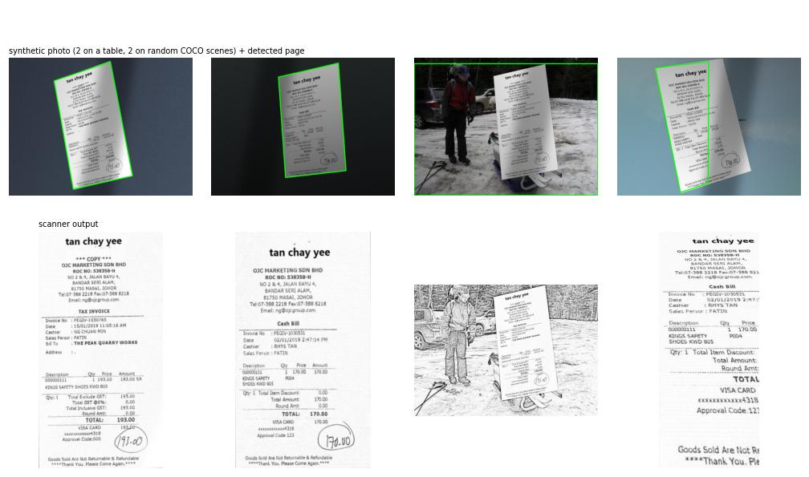

# Computer Vision Project Library

**18 end-to-end computer vision projects**, from classical OpenCV to fine-tuned detectors, segmentation,
3D, and foundation models, each **measured on a real benchmark** and documented with what worked,
what didn't and why. Everything was trained and evaluated on **a laptop CPU** (Intel Core Ultra 7, no
NVIDIA GPU), which shaped the engineering: transfer learning, careful evaluation, and deployment with
OpenVINO / ONNX / INT8.

**Portfolio:** [yandouziyassine.github.io](https://yandouziyassine.github.io) (all my projects, including this library)

## ⭐ Highlights

| | Project | Why it's interesting |
|---|---|---|
|  | **[13 · PatchCore from scratch](13-anomaly-detection-patchcore/)** | Reimplemented a CVPR 2022 anomaly-detection paper in ~150 lines of PyTorch and **matched its published numbers** (image AUROC 1.000 / 0.999 / 0.977 on MVTec AD), with no defect images seen in training. |
|  | **[19 · Edge deployment benchmark](19-edge-deployment-benchmark/)** | YOLO11n on PyTorch vs ONNX vs OpenVINO across CPU, iGPU and **NPU**: **79 ms → 4.6 ms** (17×), INT8 costs only 0.1 mAP on held-out images. Found and fixed a 4× slowdown caused by thread scheduling on hybrid CPUs. |
|  | **[15 · Fall detection](15-fall-detection/)** | Pose skeletons + temporal features tell a **fall** from **lying down on purpose**. ~97 % of falls caught within ~0.7 s, evaluated with cross-validation grouped by video, against a hand-written rule baseline. |
|  | **[17 · Zero-shot auto-labeling](17-auto-labeling/)** | Grounding DINO + SAM label images from a text prompt. Zero-shot mAP 0.558 **beats** a COCO-trained YOLO11n (0.473) but is 118× slower, hence label offline, deploy small. **[12](12-satellite-land-cover/)** shows the flip side: zero-shot CLIP gets 47 % on satellite tiles vs 98 % fine-tuned. |
|  | **[03 · Receipt scanner](03-document-scanner-ocr/) & [06 · License plates](06-license-plate-recognition/)** | Debugging stories: OCR made 11× faster by switching backend; plate reading went from **0 % → 90 %** exact match by finding that the text detector split tight crops letter by letter. |

## All projects

**Depth:** ★ working demo · ★★ measured on a benchmark · ★★★ custom method or in-depth analysis (ablations, diagnosis, comparisons)

| # | Project | Headline result | Key techniques | Depth |
|---|---|---|---|---|
| 01 | [Virtual Painter](01-virtual-painter/) | Draw in the air with hand gestures (interactive) | MediaPipe hands, gesture rules, FastAPI streaming | ★ |
| 02 | [Solar Panel Defects](02-solar-defect-classifier/) | 82.9 % test accuracy, 6 classes | Transfer learning, class imbalance, Grad-CAM (revealed shortcut learning) | ★★ |
| 03 | [Document Scanner + Receipt OCR](03-document-scanner-ocr/) | Page found 68 % (0.6 % corner error); totals 78 % on clean scans | Classical page detection, perspective warp, OCR, synthetic test photos | ★★★ |
| 04 | AI Gym Coach | — | *planned: needs videos with known rep counts* | 📋 |
| 05 | Sign Language Translator | — | *planned: needs the Kaggle Sign Language MNIST files* | 📋 |
| 06 | [License Plate Recognition](06-license-plate-recognition/) | Detection mAP50 0.983; 80–90 % of plates read exactly | YOLO11n fine-tuned on CPU, OCR, plate-format correction | ★★★ |
| 07 | [PPE Safety Monitor](07-ppe-safety-monitor/) | mAP50 0.828; 90.8 % of violations flagged | YOLO fine-tuning, alert-level metrics, threshold choice | ★★ |
| 08 | [Traffic Analytics](08-traffic-analytics/) | 19 vehicles tracked, speeds in km/h, 3.4 FPS at 4K | ByteTrack tracking, line counting, homography | ★★ |
| 09 | [Retail Shelf Monitor](09-retail-shelf-monitor/) | mAP50 0.838 on shelves of 100–700 products; count error 13 % | Dense small-object detection, counting | ★★ |
| 10 | [Face Recognition](10-face-recognition/) | 99.35 % on LFW (official 10-fold protocol) | Face alignment, embeddings, TAR@FAR, ethics & limits | ★★★ |
| 11 | [Polyp Segmentation](11-medical-segmentation/) | Dice 0.897 / IoU 0.833 | U-Net, Dice + BCE loss | ★★ |
| 12 | [Satellite Land-Cover](12-satellite-land-cover/) | 98.1 % fine-tuned vs 47.4 % zero-shot | Remote sensing, domain shift | ★★ |
| 13 | [Anomaly Detection (PatchCore)](13-anomaly-detection-patchcore/) | Image AUROC 1.000 / 0.999 / 0.977 | Paper reimplemented from scratch | ★★★ |
| 14 | [Monocular Depth → 3D](14-monocular-depth-3d/) | One photo → point cloud → new viewpoints | Depth estimation, back-projection, z-buffer rendering | ★ |
| 15 | [Fall Detection](15-fall-detection/) | ~97 % of falls caught in ~0.7 s | Pose estimation, temporal features, grouped CV | ★★★ |
| 16 | [Text-to-Image Search](16-text-to-image-search/) | Recall@10 75.2 % on COCO 5k | CLIP embeddings, FAISS, web UI | ★★ |
| 17 | [Zero-Shot Auto-Labeling](17-auto-labeling/) | mAP 0.558 zero-shot vs 0.473 supervised | Grounding DINO, SAM, COCO evaluation | ★★★ |
| 18 | [Image & Video Q&A](18-video-qa-assistant/) | VQAv2 67 % offline on CPU; prompt wording worth +9 points | Local vision-language model, limits vs specialized models | ★★★ |
| 19 | [Edge Deployment Benchmark](19-edge-deployment-benchmark/) | 17× faster on iGPU/NPU; INT8 −0.1 mAP (held-out) | ONNX, OpenVINO, INT8 quantization, profiling | ★★★ |
| 20 | [Football Analytics](20-football-analytics/) | Players AP50 0.98, ball 0.44; teams split by jersey color (silhouette 0.80) | YOLO fine-tuning, unsupervised clustering, possession | ★★ |

## Skills covered

| Area | Where |
|---|---|
| Classical CV (contours, thresholds, homography, perspective) | 03, 08, 14 |
| Image classification & transfer learning | 02, 12 |
| Object detection (fine-tuning YOLO on custom data) | 06, 07, 09, 20 |
| Tracking & video analytics | 08, 15 |
| Segmentation | 11, 17 |
| Pose estimation | 15 |
| Anomaly detection | 13 |
| Face recognition (with ethics & limits) | 10 |
| OCR & document AI | 03, 06 |
| 3D & depth | 14 |
| Foundation models (CLIP, Grounding DINO, SAM, VLMs) | 12, 16, 17, 18 |
| Explainability (Grad-CAM, error analysis) | 02, 09, 11, 13 |
| Evaluation design (grouped CV, official protocols, threshold sweeps) | 10, 15, 16, 17, 18 |
| Deployment & optimization (ONNX, OpenVINO, INT8, CPU/iGPU/NPU) | 03, 19 |

## Repository layout

```
COMPUTER-VISION-PROJECT-LIBRARY/
├── README.md              ← you are here
├── DATA_LICENSES.md       ← license of every dataset and pretrained model used
├── setup_env.ps1          ← creates the shared .venv (CPU PyTorch + everything below)
├── requirements-shared.txt
├── common/paths.py        ← data/weights/caches live outside the repo in ../cv-data/
├── tests/                 ← fast unit tests (pytest), run by CI (.github/workflows/ci.yml)
├── pyproject.toml         ← ruff (lint/format) and pytest settings
├── _template/             ← README skeleton for new projects
└── NN-project-name/       ← code, README, requirements.txt, docs/ (figures + results.json)
```

## Getting started

```powershell
powershell -ExecutionPolicy Bypass -File setup_env.ps1     # shared environment for projects 02–20
.venv\Scripts\activate
cd 16-text-to-image-search                                  # then follow that project's README
```

Project 01 has its own environment (MediaPipe needs `numpy<2`). Datasets aren't in the repo: each README
says where to get them, and `../cv-data/` is where they go.

## Conventions

- **Real numbers only.** Every README result comes from a script in that folder (`docs/results.json`).
- **What didn't work is part of the result.** Each README has a "What I learned / what didn't work" section.
- **No data or weights in git**; licenses are tracked in [DATA_LICENSES.md](DATA_LICENSES.md).

## Engineering

<!-- CI badge (enable once the repo is public):
[](https://github.com/yandouziyassine/COMPUTER-VISION-PROJECT-LIBRARY/actions/workflows/ci.yml)
-->

- **Unit tests** ([`tests/`](tests/)): fast pytest suite (a few seconds, no datasets, no network, no model
  downloads) on the pure logic of the projects: receipt parsing (03), page detection and warp (03), plate-text
  correction (06), shelf-gap rule (09), PatchCore blur and coreset sampling (13), fall features and alarm logic,
  including frame-rate independence (15), VQA answer normalization (18), team clustering and possession (20).
- **Lint and format**: [ruff](https://docs.astral.sh/ruff/), configured in [`pyproject.toml`](pyproject.toml).
- **CI**: [GitHub Actions](.github/workflows/ci.yml) runs lint and tests on Ubuntu, Python 3.10, CPU-only PyTorch.
- **Docker**: CPU images for [13 · PatchCore](13-anomaly-detection-patchcore/#run-with-docker) and
  [15 · Fall detection](15-fall-detection/#run-with-docker), with datasets mounted from `../cv-data`.

```bash
pip install -r tests/requirements-ci.txt   # or use the shared .venv
pytest -q
ruff check .
ruff format --check .
```

## License

Code: [MIT](LICENSE) © Yassine Yandouzi. Datasets and pretrained models keep their own licenses: see [DATA_LICENSES.md](DATA_LICENSES.md).
